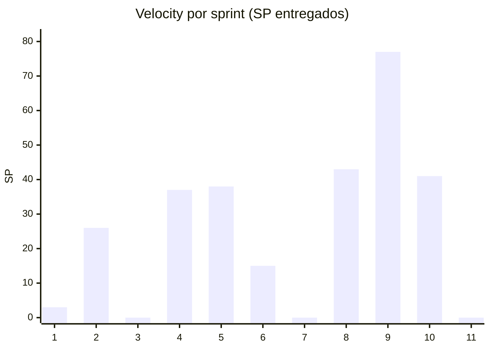

# Informes de sprint

Un informe por sprint, del 1 al 11, con las métricas que compromete el Plan de Proyecto §2.4: velocity, burndown, avance por release y Story Points completados. Los genera `datos/generar.py` a partir de la foto de Linear del **03/11/2026** y de los PRs mergeados de los cuatro repos.

## Resumen

| Sprint | Inicio | Release | Estado | Comprometido | Cumplido | Entregado (issues) | Velocity (SP) | PRs | Avance acumulado |
|---|---|---|---|---|---|---|---|---|---|
| [Sprint 1](sprint-01.md) | 22/06 | R1 · Core | cerrado | 10 · 32 SP | 2 · 3 SP (20 %) | 2 | **3** | 3 | 1 % |
| [Sprint 2](sprint-02.md) | 06/07 | R1 · Core | cerrado | 5 · 8 SP | 2 · 0 SP (40 %) | 9 | **26** | 25 | 9 % |
| [Sprint 3](sprint-03.md) | 20/07 | R1 · Core | cerrado | 4 · 0 SP | 0 · 0 SP (0 %) | 1 | **0** | 3 | 9 % |
| [Sprint 4](sprint-04.md) | 03/08 | R1 · Core | cerrado | 11 · 52 SP | 5 · 23 SP (45 %) | 12 | **37** | 27 | 21 % |
| [Sprint 5](sprint-05.md) | 17/08 | R1 · Core | cerrado | 15 · 45 SP | 3 · 10 SP (20 %) | 9 | **38** | 17 | 33 % |
| [Sprint 6](sprint-06.md) | 31/08 | R2 · Cobro | cerrado | 10 · 41 SP | 0 · 0 SP (0 %) | 6 | **15** | 17 | 38 % |
| [Sprint 7](sprint-07.md) | 14/09 | R2 · Cobro | cerrado | 9 · 37 SP | 0 · 0 SP (0 %) | 0 | **0** | 0 | 38 % |
| [Sprint 8](sprint-08.md) | 28/09 | R2 · Cobro | cerrado | 8 · 42 SP | 0 · 0 SP (0 %) | 12 | **43** | 23 | 51 % |
| [Sprint 9](sprint-09.md) | 12/10 | R3 · Chat y MediPass | cerrado | 8 · 40 SP | 4 · 19 SP (50 %) | 27 | **77** | 31 | 76 % |
| [Sprint 10](sprint-10.md) | 26/10 | R3 · Chat y MediPass | en curso | 38 · 10 SP | 25 · 8 SP (66 %) | 31 | **41** | 53 | 89 % |
| [Sprint 11](sprint-11.md) | 09/11 | R3 · Chat y MediPass | planificado | 0 · 0 SP | 0 · 0 SP (—) | 0 | **0** | 0 | 89 % |

- **Velocity promedio de los sprints cerrados:** 26.6 SP por sprint.
- **Backlog:** 109 issues terminadas y 36 abiertas, de 145.
- **Avance acumulado:** SP entregados sobre los 316 SP estimados del backlog completo (Releases 1 a 4).



## Metodología

### De dónde sale cada número

- **Comprometido:** las issues con la label `Sprint N` en Linear. Desde el Sprint 10 el equipo dejó de usar labels y planificó con el ciclo de Linear, así que para el 10 el compromiso es el ciclo.
- **Fecha de entrega:** la del **último PR mergeado** que nombra a la issue (en el título o en la rama, `ENG-XX`) hasta su cierre en Linear, con un día de margen. Si no hay PR, la fecha de cierre en Linear.
- **Velocity:** los Story Points de las issues entregadas dentro de las fechas del sprint, estuvieran comprometidas o no. Las issues sin estimar cuentan como entregadas pero no suman SP.
- **Burndown:** lo que quedaba pendiente del compromiso al final de cada día, en SP. Si nada de lo comprometido estaba estimado, en cantidad de issues.

### Las dos decisiones que hubo que tomar

**1. Fuente de verdad del sprint: la fecha, no el ciclo.** En Linear, las labels `Sprint N` y los ciclos se contradicen: el ciclo de Sprint 8 figura con 37 issues y 0 completadas, y muchas issues de los primeros sprints apuntan al ciclo de Sprint 9. Además, los sprints 1 a 4 no tienen ciclo. Por eso cada informe usa las fechas del calendario (14 días desde el lunes 22/06/2026) y no el ciclo. La label es lo que se comprometió y la fecha de entrega es lo que pasó.

**2. La fecha de entrega sale del PR, no del cierre en Linear.** El 13/10, el 20/10 y el 03/11 se cerraron decenas de issues en minutos, al poner el tablero al día. Usar esa fecha concentraría en tres días el trabajo de semanas. El merge del PR es cuándo el incremento llegó de verdad a la rama.

### Limitaciones, dichas en voz alta

- **Story Points:** las issues creadas desde octubre casi no tienen estimación, así que la velocity de los sprints 9 y 10 subestima el trabajo. Para esos sprints la cantidad de issues y de PRs dice más.
- **Issues sin PR propio** (decisiones, documentación, configuración): su fecha es la de Linear, incluso si fue un cierre en tanda.
- **El Sprint 10 está en curso y el 11 no empezó:** sus informes son una foto, no un cierre.

## Cómo regenerarlos

```sh
# 1. Foto de Linear: exportar las issues del equipo ENG a datos/linear-AAAA-MM-DD.tsv
#    (columnas: id, sp, sprint, tipo, estado, completado, titulo).
# 2. PRs mergeados de cada repo:
for r in backend web mobile docs; do
  gh pr list -R Proyecto-final-Mediconnect/mediconnect-$r --state merged --limit 400 \
    --json number,title,headRefName,mergedAt,author,url > 02-informes-de-sprint/datos/prs-$r.json
done
# 3. Generar:
python 02-informes-de-sprint/datos/generar.py
```

La [plantilla](plantilla.md) describe la estructura de cada informe.
