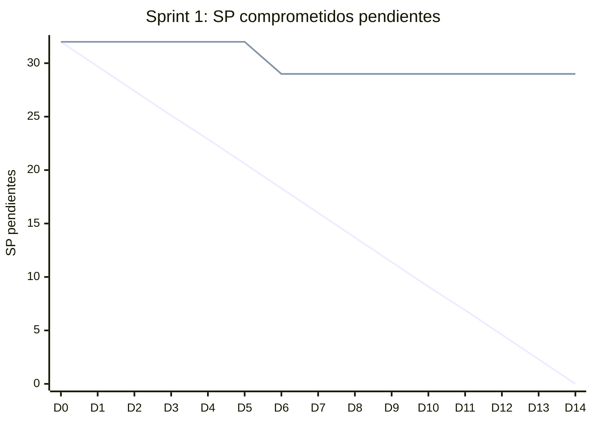

# Informe del Sprint 1

**Fechas:** 22/06/2026 al 05/07/2026 · **Release:** R1 · Core · **Estado:** cerrado

## Objetivo

Setup técnico (repos, CI/CD, base de datos) y autenticación base.

## Métricas

| Métrica | Valor |
|---|---|
| Comprometido | 10 issues · 32 SP |
| Comprometido y entregado en el sprint | 2 issues · 3 SP (20 % de los issues) |
| Entregado en el sprint (comprometido o no) | 2 issues |
| **Velocity** (SP entregados en el sprint) | **3 SP** |
| PRs mergeados | 3 |
| Entregado por tipo | TT: 2 |

## Burndown del compromiso

La línea que baja en recta es la ideal; la otra, lo que quedaba pendiente al final de cada día (SP, según la fecha de entrega). Lo que se entregó después del sprint queda como pendiente hasta el día 14.

## Historias comprometidas

| Issue | Título | Tipo | SP | Entrega | Entregado en |
|---|---|---|---|---|---|
| ENG-37 | Validación de RLS en Supabase con Prisma | Spike | 5 | 08/07 | Sprint 2 |
| ENG-38 | Setup del pipeline CI/CD con GitHub Actions | TT | 5 | 13/07 | Sprint 2 |
| ENG-39 | Setup de PostgreSQL en Docker para tests de integración | TT | 3 | 10/07 | Sprint 2 |
| ENG-40 | Exploración de Supabase Auth | Spike | 3 | 06/07 | Sprint 2 |
| ENG-41 | Setup inicial de los tres repositorios | TT | 3 | 27/06 | Sprint 1 |
| ENG-42 | Registro como paciente | HU | 5 | 06/07 | Sprint 2 |
| ENG-43 | Registro como profesional | HU | 5 | 12/07 | Sprint 2 |
| ENG-44 | Login para todos los roles | HU | 3 | 07/08 | Sprint 4 |
| ENG-89 | Diseño y documentación del modelo de datos (DER + normalización) | TT | — | 04/07 | Sprint 1 |
| ENG-92 | AuthGuard + verificación de JWT y configuración de entorno | TT | — | 18/07 | Sprint 2 |

## Entregado fuera de lo comprometido

_Nada._

## Incremento: PRs mergeados

**web** (2)

- [#1](https://github.com/Proyecto-final-Mediconnect/mediconnect-web/pull/1) Feature/eng 41 web initial setup · 27/06
- [#2](https://github.com/Proyecto-final-Mediconnect/mediconnect-web/pull/2) chore(web): enable TypeScript strict mode · 27/06

**docs** (1)

- [#1](https://github.com/Proyecto-final-Mediconnect/mediconnect-docs/pull/1) docs(data-model): add database schema, ER diagram and normalization (ENG-89) · 04/07

## Desvíos, impedimentos y decisiones

- El 04/07 se versionó el modelo de datos (DER y normalización, ENG-89).
- La release 1.0.0 del backend salió el 06/07, el primer día del Sprint 2: casi todo lo comprometido acá entró esa semana.

**No se completó en el sprint:** ENG-37 (entregada en el Sprint 2), ENG-38 (entregada en el Sprint 2), ENG-39 (entregada en el Sprint 2), ENG-40 (entregada en el Sprint 2), ENG-42 (entregada en el Sprint 2), ENG-43 (entregada en el Sprint 2), ENG-44 (entregada en el Sprint 4), ENG-92 (entregada en el Sprint 2).

---

_Generado con `datos/generar.py` a partir de la foto de Linear del 03/11/2026 y de los PRs mergeados de los cuatro repos. Metodología en el [índice](README.md)._
