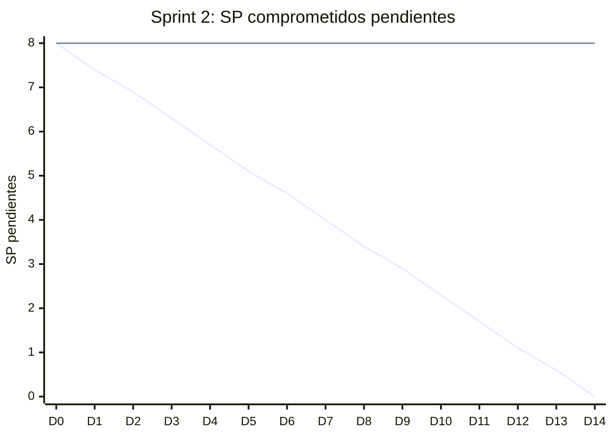

# Informe del Sprint 2

**Fechas:** 06/07/2026 al 19/07/2026 · **Release:** R1 · Core · **Estado:** cerrado

## Objetivo

Perfiles de paciente y profesional, y cimientos del catálogo.

## Métricas

| Métrica | Valor |
|---|---|
| Comprometido | 5 issues · 8 SP |
| Comprometido y entregado en el sprint | 2 issues · 0 SP (40 % de los issues) |
| Entregado en el sprint (comprometido o no) | 9 issues |
| **Velocity** (SP entregados en el sprint) | **26 SP** |
| PRs mergeados | 25 |
| Entregado por tipo | Bug: 1, HU: 2, Spike: 2, TT: 4 |

## Burndown del compromiso

La línea que baja en recta es la ideal; la otra, lo que quedaba pendiente al final de cada día (SP, según la fecha de entrega). Lo que se entregó después del sprint queda como pendiente hasta el día 14.

## Historias comprometidas

| Issue | Título | Tipo | SP | Entrega | Entregado en |
|---|---|---|---|---|---|
| ENG-47 | Completar perfil de paciente | HU | 3 | 07/08 | Sprint 4 |
| ENG-48 | Configurar perfil público del profesional | HU | 5 | 06/08 | Sprint 4 |
| ENG-90 | Configurar SMTP para envío confiable de emails de verificación | TT | — | 06/07 | Sprint 2 |
| ENG-91 | El rol de alta se toma de user_metadata: escalada de privilegios | Bug | — | 18/07 | Sprint 2 |
| ENG-94 | Exponer endpoint /me protegido con JwtAuthGuard | TT | — | 22/07 | Sprint 3 |

## Entregado fuera de lo comprometido

Entraron en este sprint, pero estaban comprometidas en otro o no tenían sprint:

| Issue | Título | Tipo | SP | Entrega | Comprometida en |
|---|---|---|---|---|---|
| ENG-37 | Validación de RLS en Supabase con Prisma | Spike | 5 | 08/07 | Sprint 1 |
| ENG-38 | Setup del pipeline CI/CD con GitHub Actions | TT | 5 | 13/07 | Sprint 1 |
| ENG-39 | Setup de PostgreSQL en Docker para tests de integración | TT | 3 | 10/07 | Sprint 1 |
| ENG-40 | Exploración de Supabase Auth | Spike | 3 | 06/07 | Sprint 1 |
| ENG-42 | Registro como paciente | HU | 5 | 06/07 | Sprint 1 |
| ENG-43 | Registro como profesional | HU | 5 | 12/07 | Sprint 1 |
| ENG-92 | AuthGuard + verificación de JWT y configuración de entorno | TT | — | 18/07 | Sprint 1 |

## Incremento: PRs mergeados

**backend** (14)

- [#1](https://github.com/Proyecto-final-Mediconnect/mediconnect-backend/pull/1) feat(auth): registro y login de paciente (ENG-42) · 06/07
- [#3](https://github.com/Proyecto-final-Mediconnect/mediconnect-backend/pull/3) feat(auth): registro como profesional (ENG-43) · 07/07
- [#5](https://github.com/Proyecto-final-Mediconnect/mediconnect-backend/pull/5) Setup de PostgreSQL en Docker para tests de integración · 08/07
- [#7](https://github.com/Proyecto-final-Mediconnect/mediconnect-backend/pull/7) feat(auth): add professional registration (ENG-43) · 08/07
- [#6](https://github.com/Proyecto-final-Mediconnect/mediconnect-backend/pull/6) Release/1.0.0 · 08/07
- [#9](https://github.com/Proyecto-final-Mediconnect/mediconnect-backend/pull/9) Feature/eng 39 esquema bd y entorno local · 10/07
- [#10](https://github.com/Proyecto-final-Mediconnect/mediconnect-backend/pull/10) Release/1.0.0 · 12/07
- [#8](https://github.com/Proyecto-final-Mediconnect/mediconnect-backend/pull/8) fix(lint): resolver errores de lint en auth (ENG-42/43) · 12/07
- [#12](https://github.com/Proyecto-final-Mediconnect/mediconnect-backend/pull/12) fix(lint): sincronizar fix de auth (ENG-42/43) de main a release/1.0.0 · 12/07
- [#11](https://github.com/Proyecto-final-Mediconnect/mediconnect-backend/pull/11) ci: setup del pipeline CI/CD con GitHub Actions (ENG-38) · 15/07
- [#13](https://github.com/Proyecto-final-Mediconnect/mediconnect-backend/pull/13) Release/1.0.0 · 15/07
- [#2](https://github.com/Proyecto-final-Mediconnect/mediconnect-backend/pull/2) feat(db): RLS de identidad + validación desde Prisma (ENG-37) · 15/07
- [#15](https://github.com/Proyecto-final-Mediconnect/mediconnect-backend/pull/15) Jgarciaamadey/security refresh token reuse mitigation · 18/07
- [#14](https://github.com/Proyecto-final-Mediconnect/mediconnect-backend/pull/14) AuthGuard + verificación de JWT y configuración de entorno (Supabase … · 18/07

**web** (6)

- [#3](https://github.com/Proyecto-final-Mediconnect/mediconnect-web/pull/3) feat(auth): pantallas de registro, login y landing (ENG-42) · 06/07
- [#4](https://github.com/Proyecto-final-Mediconnect/mediconnect-web/pull/4) feat(auth): registro como profesional (ENG-43) · 07/07
- [#5](https://github.com/Proyecto-final-Mediconnect/mediconnect-web/pull/5) feat(auth): registro como profesional (ENG-43) · 12/07
- [#6](https://github.com/Proyecto-final-Mediconnect/mediconnect-web/pull/6) Release/1.1.0 · 12/07
- [#7](https://github.com/Proyecto-final-Mediconnect/mediconnect-web/pull/7) ci: setup del pipeline CI/CD con GitHub Actions (ENG-38) · 13/07
- [#8](https://github.com/Proyecto-final-Mediconnect/mediconnect-web/pull/8) ci: mejoras de CI post-review (ENG-38) · 18/07

**mobile** (2)

- [#1](https://github.com/Proyecto-final-Mediconnect/mediconnect-mobile/pull/1) ci: setup del pipeline CI/CD con GitHub Actions (ENG-38) · 13/07
- [#2](https://github.com/Proyecto-final-Mediconnect/mediconnect-mobile/pull/2) ci: mejoras de CI post-review (ENG-38) · 18/07

**docs** (3)

- [#3](https://github.com/Proyecto-final-Mediconnect/mediconnect-docs/pull/3) docs: spike Supabase Auth (ENG-40) · 06/07
- [#4](https://github.com/Proyecto-final-Mediconnect/mediconnect-docs/pull/4) docs: spike de validación de RLS (ENG-37) · 08/07
- [#6](https://github.com/Proyecto-final-Mediconnect/mediconnect-docs/pull/6) add eng 39 docs · 08/07

## Desvíos, impedimentos y decisiones

- Se corrigió una escalada de privilegios: el rol de alta salía de `user_metadata`, que escribe el cliente (ENG-91).

**No se completó en el sprint:** ENG-47 (entregada en el Sprint 4), ENG-48 (entregada en el Sprint 4), ENG-94 (entregada en el Sprint 3).

---

_Generado con `datos/generar.py` a partir de la foto de Linear del 03/11/2026 y de los PRs mergeados de los cuatro repos. Metodología en el [índice](README.md)._
