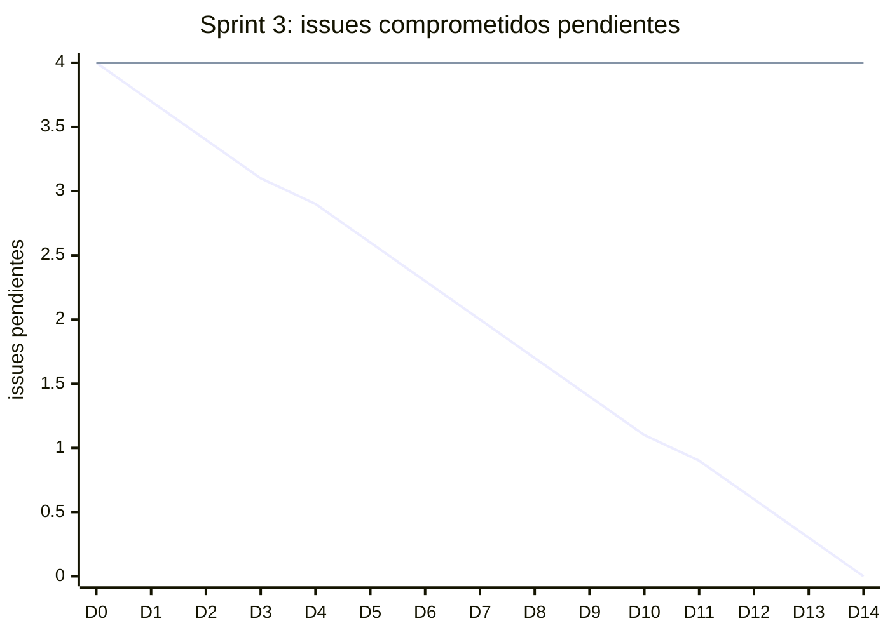

# Informe del Sprint 3

**Fechas:** 20/07/2026 al 02/08/2026 · **Release:** R1 · Core · **Estado:** cerrado

## Objetivo

Turnos y agenda; observabilidad con Sentry.

## Métricas

| Métrica | Valor |
|---|---|
| Comprometido | 4 issues · 0 SP |
| Comprometido y entregado en el sprint | 0 issues · 0 SP (0 % de los issues) |
| Entregado en el sprint (comprometido o no) | 1 issues |
| **Velocity** (SP entregados en el sprint) | **0 SP** |
| PRs mergeados | 3 |
| Entregado por tipo | TT: 1 |

## Burndown del compromiso

La línea que baja en recta es la ideal; la otra, lo que quedaba pendiente al final de cada día (issues, según la fecha de entrega). Lo que se entregó después del sprint queda como pendiente hasta el día 14.

## Historias comprometidas

| Issue | Título | Tipo | SP | Entrega | Entregado en |
|---|---|---|---|---|---|
| ENG-83 | Configurar Sentry en backend, web y mobile | TT | — | 21/10 | Sprint 9 |
| ENG-93 | Supabase no rechaza el reuso de refresh tokens | Bug | — | 07/08 | Sprint 4 |
| ENG-97 | Configurar Sentry en el backend | TT | — | 11/08 | Sprint 4 |
| ENG-98 | Configurar Sentry en la web | TT | — | 11/08 | Sprint 4 |

## Entregado fuera de lo comprometido

Entraron en este sprint, pero estaban comprometidas en otro o no tenían sprint:

| Issue | Título | Tipo | SP | Entrega | Comprometida en |
|---|---|---|---|---|---|
| ENG-94 | Exponer endpoint /me protegido con JwtAuthGuard | TT | — | 22/07 | Sprint 2 |

## Incremento: PRs mergeados

**backend** (2)

- [#16](https://github.com/Proyecto-final-Mediconnect/mediconnect-backend/pull/16) feat(auth): exponer GET /me protegido con JwtAuthGuard (ENG-94) · 22/07
- [#17](https://github.com/Proyecto-final-Mediconnect/mediconnect-backend/pull/17) Update PULL_REQUEST_TEMPLATE.md · 23/07

**web** (1)

- [#9](https://github.com/Proyecto-final-Mediconnect/mediconnect-web/pull/9) Release/1.1.0 · 20/07

## Desvíos, impedimentos y decisiones

- Fue el sprint con menos actividad del Release 1: tres PRs en dos semanas.
- Sentry, comprometido acá, entró el 11/08, en el Sprint 4 (ENG-97, ENG-98).

**No se completó en el sprint:** ENG-83 (entregada en el Sprint 9), ENG-93 (entregada en el Sprint 4), ENG-97 (entregada en el Sprint 4), ENG-98 (entregada en el Sprint 4).

---

_Generado con `datos/generar.py` a partir de la foto de Linear del 03/11/2026 y de los PRs mergeados de los cuatro repos. Metodología en el [índice](README.md)._
