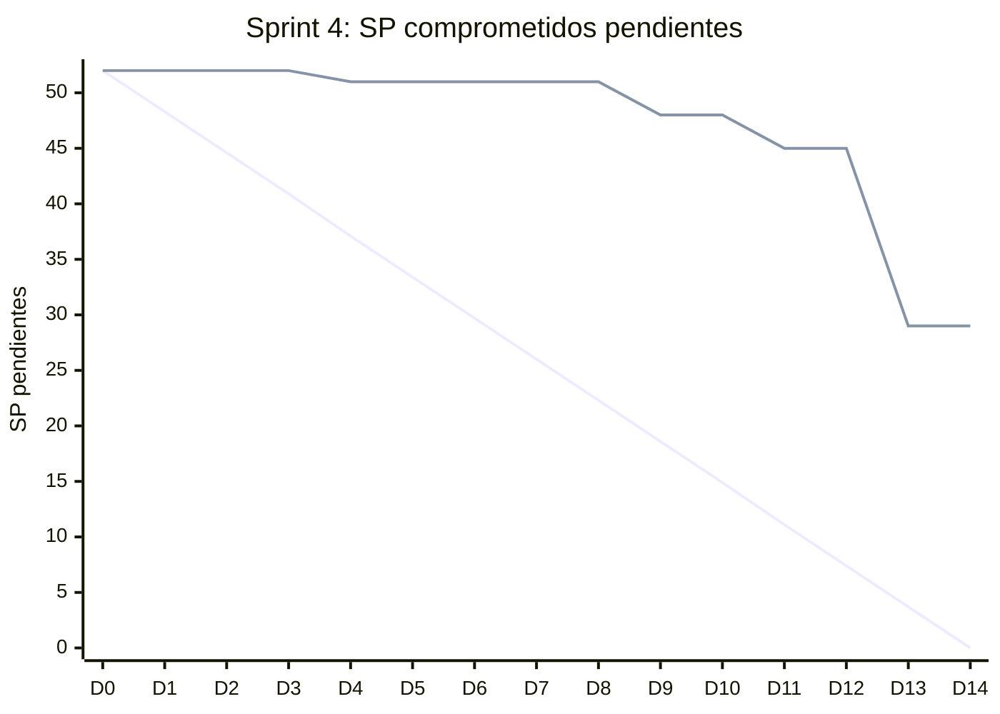

# Informe del Sprint 4

**Fechas:** 03/08/2026 al 16/08/2026 · **Release:** R1 · Core · **Estado:** cerrado

## Objetivo

Catálogo, reservas y videoconsulta, y los spikes de la historia clínica.

## Métricas

| Métrica | Valor |
|---|---|
| Comprometido | 11 issues · 52 SP |
| Comprometido y entregado en el sprint | 5 issues · 23 SP (45 % de los issues) |
| Entregado en el sprint (comprometido o no) | 12 issues |
| **Velocity** (SP entregados en el sprint) | **37 SP** |
| PRs mergeados | 27 |
| Entregado por tipo | Bug: 1, HU: 5, Spike: 2, TT: 4 |

## Burndown del compromiso

La línea que baja en recta es la ideal; la otra, lo que quedaba pendiente al final de cada día (SP, según la fecha de entrega). Lo que se entregó después del sprint queda como pendiente hasta el día 14.

## Historias comprometidas

| Issue | Título | Tipo | SP | Entrega | Entregado en |
|---|---|---|---|---|---|
| ENG-45 | Validación del prototipo de cadena de hash SHA-256 | Spike | 3 | 14/08 | Sprint 4 |
| ENG-46 | Exploración de Expo EAS Build y distribución mobile | Spike | 3 | 11/08 | Sprint 4 |
| ENG-49 | Listar y filtrar profesionales en catálogo público | HU | 8 | 15/08 | Sprint 4 |
| ENG-50 | Ver perfil público de un profesional | HU | 3 | 25/08 | Sprint 5 |
| ENG-51 | Integración con Daily.co Prebuilt en web | Spike | 5 | 25/08 | Sprint 5 |
| ENG-52 | Exploración de Supabase Realtime para chat | Spike | 2 | 29/08 | Sprint 5 |
| ENG-53 | Configurar agenda semanal del profesional | HU | 8 | 15/08 | Sprint 4 |
| ENG-54 | Ver disponibilidad y reservar un turno | HU | 8 | 25/08 | Sprint 5 |
| ENG-55 | Ver mis turnos | HU | 3 | 25/08 | Sprint 5 |
| ENG-56 | Ingresar a videoconsulta desde turno confirmado | HU | 8 | 28/08 | Sprint 5 |
| ENG-96 | El catálogo de especialidades nunca se cargó en Supabase | TT | 1 | 06/08 | Sprint 4 |

## Entregado fuera de lo comprometido

Entraron en este sprint, pero estaban comprometidas en otro o no tenían sprint:

| Issue | Título | Tipo | SP | Entrega | Comprometida en |
|---|---|---|---|---|---|
| ENG-44 | Login para todos los roles | HU | 3 | 07/08 | Sprint 1 |
| ENG-47 | Completar perfil de paciente | HU | 3 | 07/08 | Sprint 2 |
| ENG-48 | Configurar perfil público del profesional | HU | 5 | 06/08 | Sprint 2 |
| ENG-85 | Implementar job de verificación periódica de integridad de la cadena de hash | TT | 3 | 15/08 | Sprint 5 |
| ENG-93 | Supabase no rechaza el reuso de refresh tokens | Bug | — | 07/08 | Sprint 3 |
| ENG-97 | Configurar Sentry en el backend | TT | — | 11/08 | Sprint 3 |
| ENG-98 | Configurar Sentry en la web | TT | — | 11/08 | Sprint 3 |

## Incremento: PRs mergeados

**backend** (13)

- [#19](https://github.com/Proyecto-final-Mediconnect/mediconnect-backend/pull/19) feat(professionals): endpoints de perfil público del profesional (ENG-48) · 06/08
- [#22](https://github.com/Proyecto-final-Mediconnect/mediconnect-backend/pull/22) fix(build): restaurar dist/main.js y arreglar start:prod · 06/08
- [#21](https://github.com/Proyecto-final-Mediconnect/mediconnect-backend/pull/21) feat(auth): rate limiting en login (ENG-44) · 06/08
- [#23](https://github.com/Proyecto-final-Mediconnect/mediconnect-backend/pull/23) feat(patients): completar y editar perfil de paciente (ENG-47) · 06/08
- [#20](https://github.com/Proyecto-final-Mediconnect/mediconnect-backend/pull/20) Release 1.2.0 · 06/08
- [#24](https://github.com/Proyecto-final-Mediconnect/mediconnect-backend/pull/24) ENG-96: cargar el catálogo de especialidades en Supabase + documentar el pooler · 06/08
- [#26](https://github.com/Proyecto-final-Mediconnect/mediconnect-backend/pull/26) feat(observability): integrar Sentry en el backend (ENG-97) · 11/08
- [#27](https://github.com/Proyecto-final-Mediconnect/mediconnect-backend/pull/27) feat(hash-chain): prototipo de cadena de hash SHA-256 para la HC (ENG-45) · 14/08
- [#28](https://github.com/Proyecto-final-Mediconnect/mediconnect-backend/pull/28) feat(schedules): agenda semanal del profesional (ENG-53) · 15/08
- [#29](https://github.com/Proyecto-final-Mediconnect/mediconnect-backend/pull/29) feat(catalog): listado público y filtrado de profesionales (ENG-49) · 15/08
- [#30](https://github.com/Proyecto-final-Mediconnect/mediconnect-backend/pull/30) feat(professionals): perfil público de un profesional (ENG-50) · 15/08
- [#31](https://github.com/Proyecto-final-Mediconnect/mediconnect-backend/pull/31) feat(integrity): job semanal de verificación de la cadena de hash de la HC (ENG-85) · 15/08
- [#34](https://github.com/Proyecto-final-Mediconnect/mediconnect-backend/pull/34) ci(deploy): aplicar el esquema en el workflow, no en el pre-deploy de Render (ENG-122) · 15/08

**web** (8)

- [#10](https://github.com/Proyecto-final-Mediconnect/mediconnect-web/pull/10) feat(profile): página de perfil público del profesional (ENG-48) · 06/08
- [#11](https://github.com/Proyecto-final-Mediconnect/mediconnect-web/pull/11) feat(auth): sesión, rutas protegidas y dashboards por rol (ENG-44) · 07/08
- [#12](https://github.com/Proyecto-final-Mediconnect/mediconnect-web/pull/12) feat(profile): página de perfil de paciente (ENG-47) · 07/08
- [#13](https://github.com/Proyecto-final-Mediconnect/mediconnect-web/pull/13) feat(observability): integrar Sentry en la web (ENG-98) · 11/08
- [#14](https://github.com/Proyecto-final-Mediconnect/mediconnect-web/pull/14) feat(schedule): pantalla de agenda semanal del profesional (ENG-53) · 15/08
- [#15](https://github.com/Proyecto-final-Mediconnect/mediconnect-web/pull/15) feat(catalog): listado público de profesionales con filtros (ENG-49) · 15/08
- [#16](https://github.com/Proyecto-final-Mediconnect/mediconnect-web/pull/16) chore(web): aplica prettier al código que había quedado sin formatear · 15/08
- [#18](https://github.com/Proyecto-final-Mediconnect/mediconnect-web/pull/18) feat(appointments): calendario de disponibilidad y reserva de turno (ENG-54) · 15/08

**mobile** (1)

- [#3](https://github.com/Proyecto-final-Mediconnect/mediconnect-mobile/pull/3) Release/sprint 1 · 11/08

**docs** (5)

- [#7](https://github.com/Proyecto-final-Mediconnect/mediconnect-docs/pull/7) docs(data-model): ciclo de vida de la fila patients (ENG-47) · 07/08
- [#5](https://github.com/Proyecto-final-Mediconnect/mediconnect-docs/pull/5) Release/1.0.0 · 07/08
- [#8](https://github.com/Proyecto-final-Mediconnect/mediconnect-docs/pull/8) docs: spike de Expo EAS Build y distribución mobile (ENG-46) · 11/08
- [#9](https://github.com/Proyecto-final-Mediconnect/mediconnect-docs/pull/9) docs(spikes): informe del spike de cadena de hash SHA-256 (ENG-45) · 13/08
- [#10](https://github.com/Proyecto-final-Mediconnect/mediconnect-docs/pull/10) docs(spikes): informe del spike de Daily.co Prebuilt en web (ENG-51) · 15/08

## Desvíos, impedimentos y decisiones

- Los spikes de cadena de hash (ENG-45), Realtime (ENG-52) y Expo EAS (ENG-46) se cerraron antes de construir sobre ellos.

**No se completó en el sprint:** ENG-50 (entregada en el Sprint 5), ENG-51 (entregada en el Sprint 5), ENG-52 (entregada en el Sprint 5), ENG-54 (entregada en el Sprint 5), ENG-55 (entregada en el Sprint 5), ENG-56 (entregada en el Sprint 5).

---

_Generado con `datos/generar.py` a partir de la foto de Linear del 03/11/2026 y de los PRs mergeados de los cuatro repos. Metodología en el [índice](README.md)._
