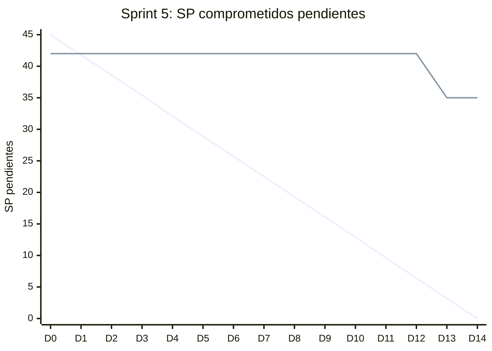

# Informe del Sprint 5

**Fechas:** 17/08/2026 al 30/08/2026 · **Release:** R1 · Core · **Estado:** cerrado

## Objetivo

Historia clínica funcional con cadena de hash, y decisión del alcance mobile.

## Métricas

| Métrica | Valor |
|---|---|
| Comprometido | 15 issues · 45 SP |
| Comprometido y entregado en el sprint | 3 issues · 10 SP (20 % de los issues) |
| Entregado en el sprint (comprometido o no) | 9 issues |
| **Velocity** (SP entregados en el sprint) | **38 SP** |
| PRs mergeados | 17 |
| Entregado por tipo | Bug: 1, HU: 5, Spike: 2, TT: 1 |

## Burndown del compromiso

La línea que baja en recta es la ideal; la otra, lo que quedaba pendiente al final de cada día (SP, según la fecha de entrega). Lo que se entregó después del sprint queda como pendiente hasta el día 14.

## Historias comprometidas

| Issue | Título | Tipo | SP | Entrega | Entregado en |
|---|---|---|---|---|---|
| ENG-57 | Modelo de datos de Historia Clínica con hash chain | HU | 5 | 29/08 | Sprint 5 |
| ENG-58 | Agregar entrada a la HC durante o después de una consulta | HU | 5 | 08/09 | Sprint 6 |
| ENG-59 | Visualizar la HC propia como paciente | HU | 3 | 08/09 | Sprint 6 |
| ENG-60 | Visualizar HC de un paciente como profesional | HU | 3 | 08/09 | Sprint 6 |
| ENG-85 | Implementar job de verificación periódica de integridad de la cadena de hash | TT | 3 | 15/08 | Sprint 4 |
| ENG-100 | Corregir una entrada de HC | HU | 5 | 13/10 | Sprint 9 |
| ENG-109 | Definir y documentar el procedimiento manual de validación de matrícula | TT | — | 05/10 | Sprint 8 |
| ENG-110 | ADR-016: Decidir la tecnología de navegación de la app mobile | TT | 2 | 05/10 | Sprint 8 |
| ENG-111 | Documentar el recorte de alcance mobile | TT | 3 | 05/10 | Sprint 8 |
| ENG-112 | Inicializar el proyecto EAS y generar el primer build de desarrollo Android | TT | 3 | 06/10 | Sprint 8 |
| ENG-113 | Shell de la app mobile: navegación raíz, tema y layout base | TT | 5 | 05/10 | Sprint 8 |
| ENG-121 | Checklist de testing manual en emulador Android para historias mobile | TT | 2 | 03/11 | Sprint 10 |
| ENG-123 | Anclaje externo semanal del hash de cabeza de las cadenas de HC | TT | 2 | 08/09 | Sprint 6 |
| ENG-124 | Las rutas del cliente devuelven 404 al entrar por URL directa | Bug | 2 | 29/08 | Sprint 5 |
| ENG-126 | Endurecer el modelo de HC: TRUNCATE, SECURITY DEFINER y corrección entre pacientes | TT | 2 | 08/09 | Sprint 6 |

## Entregado fuera de lo comprometido

Entraron en este sprint, pero estaban comprometidas en otro o no tenían sprint:

| Issue | Título | Tipo | SP | Entrega | Comprometida en |
|---|---|---|---|---|---|
| ENG-50 | Ver perfil público de un profesional | HU | 3 | 25/08 | Sprint 4 |
| ENG-51 | Integración con Daily.co Prebuilt en web | Spike | 5 | 25/08 | Sprint 4 |
| ENG-52 | Exploración de Supabase Realtime para chat | Spike | 2 | 29/08 | Sprint 4 |
| ENG-54 | Ver disponibilidad y reservar un turno | HU | 8 | 25/08 | Sprint 4 |
| ENG-55 | Ver mis turnos | HU | 3 | 25/08 | Sprint 4 |
| ENG-56 | Ingresar a videoconsulta desde turno confirmado | HU | 8 | 28/08 | Sprint 4 |
| ENG-122 | Aplicar las migraciones de Prisma automáticamente en el deploy | TT | 2 | 25/08 | sin sprint |

## Incremento: PRs mergeados

**backend** (9)

- [#33](https://github.com/Proyecto-final-Mediconnect/mediconnect-backend/pull/33) feat(appointments): ver disponibilidad y reservar un turno (ENG-54) · 25/08
- [#32](https://github.com/Proyecto-final-Mediconnect/mediconnect-backend/pull/32) feat(video): crear sala privada de Daily.co desde el backend (ENG-51) · 25/08
- [#35](https://github.com/Proyecto-final-Mediconnect/mediconnect-backend/pull/35) feat(appointments): cancelar un turno futuro (ENG-55) · 25/08
- [#39](https://github.com/Proyecto-final-Mediconnect/mediconnect-backend/pull/39) Release 1.2.0 · 25/08
- [#40](https://github.com/Proyecto-final-Mediconnect/mediconnect-backend/pull/40) ci(deploy): generar el Prisma Client antes del seed (ENG-122) · 25/08
- [#41](https://github.com/Proyecto-final-Mediconnect/mediconnect-backend/pull/41) fix(auth): SameSite=None en producción para que la sesión sobreviva cross-site · 25/08
- [#42](https://github.com/Proyecto-final-Mediconnect/mediconnect-backend/pull/42) feat(video): ingresar a la videoconsulta de un turno (ENG-56) · 28/08
- [#37](https://github.com/Proyecto-final-Mediconnect/mediconnect-backend/pull/37) feat(realtime): prototipo de aislamiento de Supabase Realtime con RLS (ENG-52) · 29/08
- [#43](https://github.com/Proyecto-final-Mediconnect/mediconnect-backend/pull/43) feat(clinical-records): modelo de datos de HC con cadena de hash (ENG-57) · 29/08

**web** (7)

- [#17](https://github.com/Proyecto-final-Mediconnect/mediconnect-web/pull/17) feat(video): página de prueba con Daily Prebuilt embebido (ENG-51) · 25/08
- [#20](https://github.com/Proyecto-final-Mediconnect/mediconnect-web/pull/20) feat(appointments): pantalla de mis turnos con cancelación (ENG-55) · 25/08
- [#22](https://github.com/Proyecto-final-Mediconnect/mediconnect-web/pull/22) sync: traer main a release/1.2.0 · 25/08
- [#19](https://github.com/Proyecto-final-Mediconnect/mediconnect-web/pull/19) Release/1.2.0 · 25/08
- [#23](https://github.com/Proyecto-final-Mediconnect/mediconnect-web/pull/23) feat(catalog): perfil público del profesional y enlace desde el catálogo (ENG-50) · 25/08
- [#25](https://github.com/Proyecto-final-Mediconnect/mediconnect-web/pull/25) feat(video): pantalla de videoconsulta desde el turno (ENG-56) · 28/08
- [#24](https://github.com/Proyecto-final-Mediconnect/mediconnect-web/pull/24) fix(deploy): declarar el rewrite de SPA del static site (ENG-124) · 29/08

**docs** (1)

- [#11](https://github.com/Proyecto-final-Mediconnect/mediconnect-docs/pull/11) docs(spikes): informe del spike de Supabase Realtime para chat (ENG-52) · 25/08

## Desvíos, impedimentos y decisiones

- **Desvío de alcance:** se recortó la app mobile al flujo del paciente y se documentó en el addendum (ENG-111).
- **Desvío de testing:** Detox quedó fuera del proyecto por ADR-017, y la evidencia mobile pasa a ser el checklist de emulador (ENG-121).

**No se completó en el sprint:** ENG-58 (entregada en el Sprint 6), ENG-59 (entregada en el Sprint 6), ENG-60 (entregada en el Sprint 6), ENG-100 (entregada en el Sprint 9), ENG-109 (entregada en el Sprint 8), ENG-110 (entregada en el Sprint 8), ENG-111 (entregada en el Sprint 8), ENG-112 (entregada en el Sprint 8), ENG-113 (entregada en el Sprint 8), ENG-121 (entregada en el Sprint 10), ENG-123 (entregada en el Sprint 6), ENG-126 (entregada en el Sprint 6).

---

_Generado con `datos/generar.py` a partir de la foto de Linear del 03/11/2026 y de los PRs mergeados de los cuatro repos. Metodología en el [índice](README.md)._
