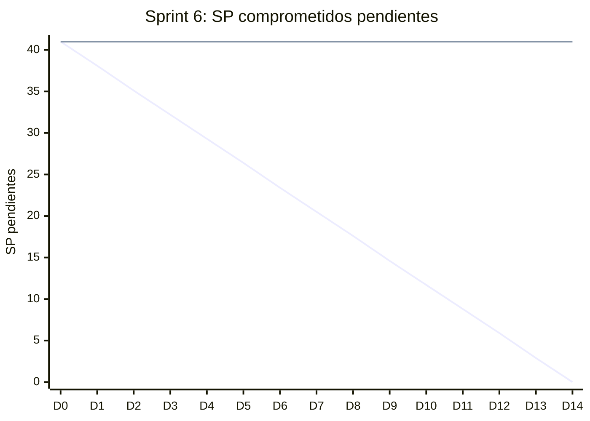

# Informe del Sprint 6

**Fechas:** 31/08/2026 al 13/09/2026 · **Release:** R2 · Cobro · **Estado:** cerrado

## Objetivo

Cobro con MercadoPago, rate limiting, backup y primeros pasos de la app mobile.

## Métricas

| Métrica | Valor |
|---|---|
| Comprometido | 10 issues · 41 SP |
| Comprometido y entregado en el sprint | 0 issues · 0 SP (0 % de los issues) |
| Entregado en el sprint (comprometido o no) | 6 issues |
| **Velocity** (SP entregados en el sprint) | **15 SP** |
| PRs mergeados | 17 |
| Entregado por tipo | HU: 3, TT: 3 |

## Burndown del compromiso

La línea que baja en recta es la ideal; la otra, lo que quedaba pendiente al final de cada día (SP, según la fecha de entrega). Lo que se entregó después del sprint queda como pendiente hasta el día 14.

## Historias comprometidas

| Issue | Título | Tipo | SP | Entrega | Entregado en |
|---|---|---|---|---|---|
| ENG-61 | Exploración de MercadoPago Checkout y webhooks | Spike | 3 | 05/10 | Sprint 8 |
| ENG-63 | Integrar pago de turno con MercadoPago al reservar | HU | 8 | 20/10 | Sprint 9 |
| ENG-64 | Recibir webhook de MercadoPago y confirmar el turno automáticamente | HU | 5 | 05/10 | Sprint 8 |
| ENG-67 | Definir política de cancelación con plazos y reembolsos | HU | 3 | 22/10 | Sprint 9 |
| ENG-84 | Implementar rate limiting global en el backend | TT | 3 | 01/10 | Sprint 8 |
| ENG-99 | Configurar Sentry en mobile (Expo) | TT | 2 | 19/10 | Sprint 9 |
| ENG-101 | Liberar automáticamente turnos no pagados después de 15 minutos | HU | 3 | 20/10 | Sprint 9 |
| ENG-108 | Implementar política de retención y backup de Supabase | TT | 3 | 13/10 | Sprint 9 |
| ENG-114 | Iniciar sesión desde la app mobile con sesión persistida | HU | 8 | 06/10 | Sprint 8 |
| ENG-119 | Generar el build interno distribuible de la app mobile para la demo | TT | 3 | — | In Progress |

## Entregado fuera de lo comprometido

Entraron en este sprint, pero estaban comprometidas en otro o no tenían sprint:

| Issue | Título | Tipo | SP | Entrega | Comprometida en |
|---|---|---|---|---|---|
| ENG-58 | Agregar entrada a la HC durante o después de una consulta | HU | 5 | 08/09 | Sprint 5 |
| ENG-59 | Visualizar la HC propia como paciente | HU | 3 | 08/09 | Sprint 5 |
| ENG-60 | Visualizar HC de un paciente como profesional | HU | 3 | 08/09 | Sprint 5 |
| ENG-123 | Anclaje externo semanal del hash de cabeza de las cadenas de HC | TT | 2 | 08/09 | Sprint 5 |
| ENG-126 | Endurecer el modelo de HC: TRUNCATE, SECURITY DEFINER y corrección entre pacientes | TT | 2 | 08/09 | Sprint 5 |
| ENG-129 | Rediseño del frontend web según el canvas de diseño | TT | — | 08/09 | sin sprint |

## Incremento: PRs mergeados

**backend** (11)

- [#38](https://github.com/Proyecto-final-Mediconnect/mediconnect-backend/pull/38) ci: disparar el pipeline en todas las ramas y en todos los PRs · 01/09
- [#45](https://github.com/Proyecto-final-Mediconnect/mediconnect-backend/pull/45) ci(integration): smoke test que verifica que el bundle de producción arranca (ENG-95) · 03/09
- [#44](https://github.com/Proyecto-final-Mediconnect/mediconnect-backend/pull/44) feat(clinical-records): agregar una entrada a la HC (ENG-58) · 08/09
- [#48](https://github.com/Proyecto-final-Mediconnect/mediconnect-backend/pull/48) fix(professionals): la subida de foto de perfil nunca funcionó · 08/09
- [#50](https://github.com/Proyecto-final-Mediconnect/mediconnect-backend/pull/50) chore(prisma): seed de datos de demo, relativo a now() · 08/09
- [#51](https://github.com/Proyecto-final-Mediconnect/mediconnect-backend/pull/51) feat(clinical-records): cada entrada de la HC dice quién la firmó (ENG-59) · 08/09
- [#52](https://github.com/Proyecto-final-Mediconnect/mediconnect-backend/pull/52) feat(catalog): filtrar por una o más especialidades · 08/09
- [#49](https://github.com/Proyecto-final-Mediconnect/mediconnect-backend/pull/49) feat(appointments): ampliar el horizonte de reserva a dos meses · 08/09
- [#46](https://github.com/Proyecto-final-Mediconnect/mediconnect-backend/pull/46) feat(clinical-records): el profesional ve la HC completa de su paciente (ENG-60) · 08/09
- [#36](https://github.com/Proyecto-final-Mediconnect/mediconnect-backend/pull/36) feat(integrity): ancla externa semanal del hash de cabeza de las cadenas (ENG-123) · 08/09
- [#47](https://github.com/Proyecto-final-Mediconnect/mediconnect-backend/pull/47) fix(clinical-records): cerrar tres huecos del modelo de HC (ENG-126) · 08/09

**web** (6)

- [#21](https://github.com/Proyecto-final-Mediconnect/mediconnect-web/pull/21) ci: disparar el pipeline en todas las ramas y en todos los PRs · 01/09
- [#26](https://github.com/Proyecto-final-Mediconnect/mediconnect-web/pull/26) feat(clinical-records): formulario e historia clínica del paciente (ENG-58) · 08/09
- [#32](https://github.com/Proyecto-final-Mediconnect/mediconnect-web/pull/32) feat(clinical-records): el paciente ve su historia clínica (ENG-59) · 08/09
- [#33](https://github.com/Proyecto-final-Mediconnect/mediconnect-web/pull/33) feat(catalog): permitir filtrar por una o más especialidades · 08/09
- [#31](https://github.com/Proyecto-final-Mediconnect/mediconnect-web/pull/31) feat(web): rediseño del frontend según el canvas de diseño (ENG-129) · 08/09
- [#34](https://github.com/Proyecto-final-Mediconnect/mediconnect-web/pull/34) feat(clinical-records): rehacer la historia clínica — rediseño, filtros, alta en diálogo y corrección de textos post-ENG-60 · 08/09

## Desvíos, impedimentos y decisiones

- El pago con MercadoPago, el centro de este sprint, entró recién el 20/10, en el Sprint 9 (ENG-63).

**No se completó en el sprint:** ENG-61 (entregada en el Sprint 8), ENG-63 (entregada en el Sprint 9), ENG-64 (entregada en el Sprint 8), ENG-67 (entregada en el Sprint 9), ENG-84 (entregada en el Sprint 8), ENG-99 (entregada en el Sprint 9), ENG-101 (entregada en el Sprint 9), ENG-108 (entregada en el Sprint 9), ENG-114 (entregada en el Sprint 8), ENG-119 (In Progress).

---

_Generado con `datos/generar.py` a partir de la foto de Linear del 03/11/2026 y de los PRs mergeados de los cuatro repos. Metodología en el [índice](README.md)._
