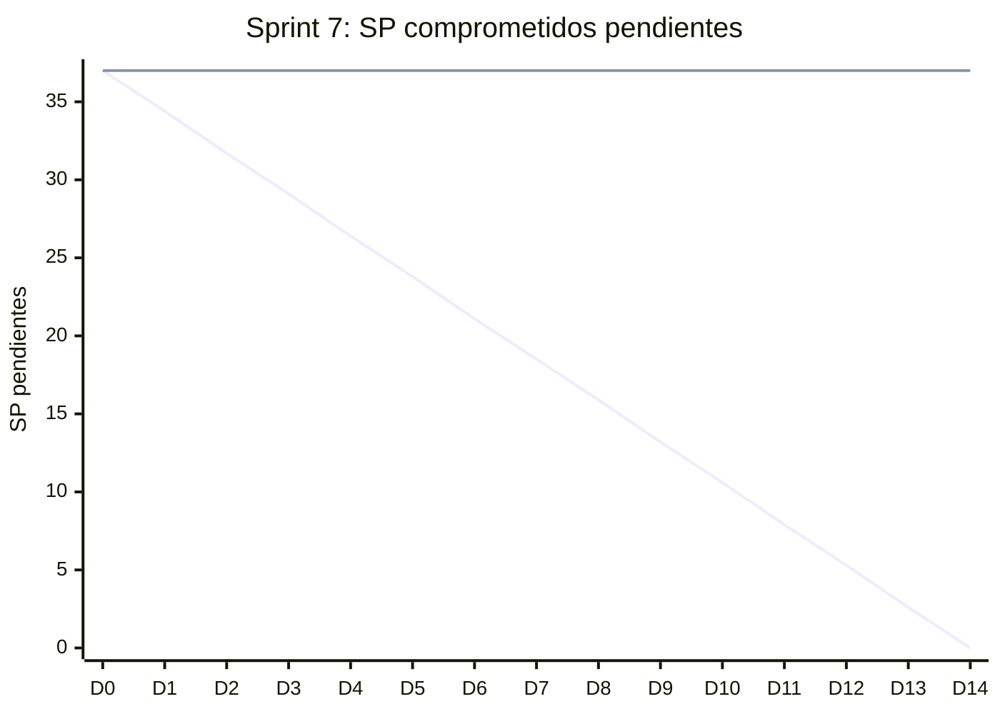

# Informe del Sprint 7

**Fechas:** 14/09/2026 al 27/09/2026 · **Release:** R2 · Cobro · **Estado:** cerrado

## Objetivo

Cierre del Release 2 (cancelaciones, reembolsos, emails) y la app mobile del paciente.

## Métricas

| Métrica | Valor |
|---|---|
| Comprometido | 9 issues · 37 SP |
| Comprometido y entregado en el sprint | 0 issues · 0 SP (0 % de los issues) |
| Entregado en el sprint (comprometido o no) | 0 issues |
| **Velocity** (SP entregados en el sprint) | **0 SP** |
| PRs mergeados | 0 |
| Entregado por tipo | — |

## Burndown del compromiso

La línea que baja en recta es la ideal; la otra, lo que quedaba pendiente al final de cada día (SP, según la fecha de entrega). Lo que se entregó después del sprint queda como pendiente hasta el día 14.

## Historias comprometidas

| Issue | Título | Tipo | SP | Entrega | Entregado en |
|---|---|---|---|---|---|
| ENG-65 | Cancelar un turno y recibir reembolso si corresponde | HU | 5 | 27/10 | Sprint 10 |
| ENG-66 | Reprogramar un turno respetando la política de cancelación del profesional | HU | 5 | 27/10 | Sprint 10 |
| ENG-68 | Enviar email de confirmación al reservar y recordatorios | HU | 8 | 20/10 | Sprint 9 |
| ENG-69 | Notificar in-app al profesional cuando un paciente reserva un turno | HU | 3 | 22/10 | Sprint 9 |
| ENG-86 | Implementar endpoints ARCO de la Ley 25.326 | TT | 5 | — | In Review |
| ENG-115 | Ver mis turnos desde la app mobile | HU | 5 | 06/10 | Sprint 8 |
| ENG-116 | Ver mi historia clínica desde la app mobile | HU | 5 | 06/10 | Sprint 8 |
| ENG-120 | Configurar Detox para tests E2E de la app mobile | TT | — | — | Backlog |
| ENG-130 | Actualizar la app mobile a Expo SDK 57 | TT | 1 | 14/10 | Sprint 9 |

## Entregado fuera de lo comprometido

_Nada._

## Incremento: PRs mergeados

_No se mergeó ningún PR en estas fechas._

## Desvíos, impedimentos y decisiones

- **No se mergeó ningún PR en los cuatro repos entre el 14/09 y el 27/09.** Lo comprometido acá (la app mobile del paciente, cancelaciones y emails) entró entre los sprints 8 y 10.

**No se completó en el sprint:** ENG-65 (entregada en el Sprint 10), ENG-66 (entregada en el Sprint 10), ENG-68 (entregada en el Sprint 9), ENG-69 (entregada en el Sprint 9), ENG-86 (In Review), ENG-115 (entregada en el Sprint 8), ENG-116 (entregada en el Sprint 8), ENG-120 (Backlog), ENG-130 (entregada en el Sprint 9).

---

_Generado con `datos/generar.py` a partir de la foto de Linear del 03/11/2026 y de los PRs mergeados de los cuatro repos. Metodología en el [índice](README.md)._
