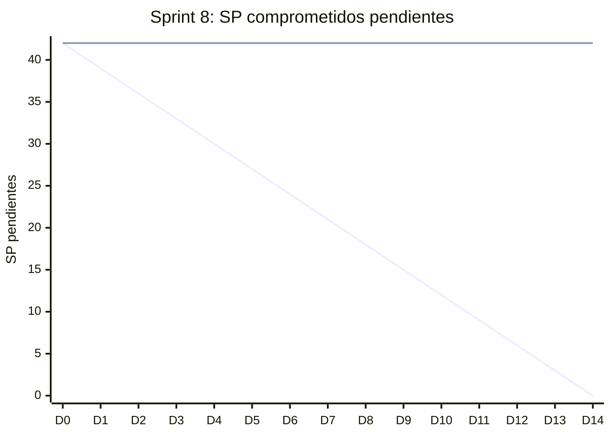

# Informe del Sprint 8

**Fechas:** 28/09/2026 al 11/10/2026 · **Release:** R2 · Cobro · **Estado:** cerrado

## Objetivo

MediPass para la jornada del 06/10, chat y auditoría de accesos.

## Métricas

| Métrica | Valor |
|---|---|
| Comprometido | 8 issues · 42 SP |
| Comprometido y entregado en el sprint | 0 issues · 0 SP (0 % de los issues) |
| Entregado en el sprint (comprometido o no) | 12 issues |
| **Velocity** (SP entregados en el sprint) | **43 SP** |
| PRs mergeados | 23 |
| Entregado por tipo | HU: 4, Spike: 1, TT: 7 |

## Burndown del compromiso

La línea que baja en recta es la ideal; la otra, lo que quedaba pendiente al final de cada día (SP, según la fecha de entrega). Lo que se entregó después del sprint queda como pendiente hasta el día 14.

## Historias comprometidas

| Issue | Título | Tipo | SP | Entrega | Entregado en |
|---|---|---|---|---|---|
| ENG-70 | Enviar y recibir mensajes entre paciente y profesional fuera de la consulta | HU | 8 | 27/10 | Sprint 10 |
| ENG-72 | Generar código MediPass rotatorio cada 5 minutos | HU | 8 | 20/10 | Sprint 9 |
| ENG-76 | Ver el historial de accesos a mi MediPass | HU | 3 | 22/10 | Sprint 9 |
| ENG-87 | Implementar audit log inmutable de accesos a HC y MediPass | TT | 5 | 19/10 | Sprint 9 |
| ENG-88 | Implementar MFA TOTP opcional para todos los usuarios | TT | 5 | — | Backlog |
| ENG-102 | Compartir archivos en el chat | HU | 5 | — | Backlog |
| ENG-104 | Expirar automáticamente las sesiones MediPass después de 30 minutos | HU | 3 | 03/11 | Sprint 10 |
| ENG-105 | Validación del diseño criptográfico del código MediPass | Spike | 5 | 03/11 | Sprint 10 |

## Entregado fuera de lo comprometido

Entraron en este sprint, pero estaban comprometidas en otro o no tenían sprint:

| Issue | Título | Tipo | SP | Entrega | Comprometida en |
|---|---|---|---|---|---|
| ENG-61 | Exploración de MercadoPago Checkout y webhooks | Spike | 3 | 05/10 | Sprint 6 |
| ENG-64 | Recibir webhook de MercadoPago y confirmar el turno automáticamente | HU | 5 | 05/10 | Sprint 6 |
| ENG-84 | Implementar rate limiting global en el backend | TT | 3 | 01/10 | Sprint 6 |
| ENG-109 | Definir y documentar el procedimiento manual de validación de matrícula | TT | — | 05/10 | Sprint 5 |
| ENG-110 | ADR-016: Decidir la tecnología de navegación de la app mobile | TT | 2 | 05/10 | Sprint 5 |
| ENG-111 | Documentar el recorte de alcance mobile | TT | 3 | 05/10 | Sprint 5 |
| ENG-112 | Inicializar el proyecto EAS y generar el primer build de desarrollo Android | TT | 3 | 06/10 | Sprint 5 |
| ENG-113 | Shell de la app mobile: navegación raíz, tema y layout base | TT | 5 | 05/10 | Sprint 5 |
| ENG-114 | Iniciar sesión desde la app mobile con sesión persistida | HU | 8 | 06/10 | Sprint 6 |
| ENG-115 | Ver mis turnos desde la app mobile | HU | 5 | 06/10 | Sprint 7 |
| ENG-116 | Ver mi historia clínica desde la app mobile | HU | 5 | 06/10 | Sprint 7 |
| ENG-127 | El repositorio de documentación no tiene protección de rama en main | TT | 1 | 05/10 | sin sprint |

## Incremento: PRs mergeados

**backend** (7)

- [#53](https://github.com/Proyecto-final-Mediconnect/mediconnect-backend/pull/53) fix(security): contar el rate limit por cliente y no por IP de Cloudflare (ENG-84) · 01/10
- [#57](https://github.com/Proyecto-final-Mediconnect/mediconnect-backend/pull/57) Jgarciaamadey/eng 64 recibir webhook de mercadopago y confirmar el turno · 01/10
- [#59](https://github.com/Proyecto-final-Mediconnect/mediconnect-backend/pull/59) fix(payments): sacar el spike de ENG-61 y cerrar la review de ENG-64 · 05/10
- [#54](https://github.com/Proyecto-final-Mediconnect/mediconnect-backend/pull/54) feat(auth): login y refresh con los tokens en el body para la app mobile (ENG-114) · 05/10
- [#55](https://github.com/Proyecto-final-Mediconnect/mediconnect-backend/pull/55) feat(clinical-records): corregir una entrada de HC sin tocar la original (ENG-100) · 05/10
- [#56](https://github.com/Proyecto-final-Mediconnect/mediconnect-backend/pull/56) docs(backend): procedimiento manual de validación de matrículas (ENG-109) · 05/10
- [#58](https://github.com/Proyecto-final-Mediconnect/mediconnect-backend/pull/58) Release 2.0.0 · 05/10

**web** (3)

- [#37](https://github.com/Proyecto-final-Mediconnect/mediconnect-web/pull/37) feat(juego): "Médico de guardia", el juego del stand para la jornada del 06/10 · 06/10
- [#38](https://github.com/Proyecto-final-Mediconnect/mediconnect-web/pull/38) feat(juego): código de un minuto, casos más simples y layout para iPad · 06/10
- [#39](https://github.com/Proyecto-final-Mediconnect/mediconnect-web/pull/39) fix(juego): que la ficha del celular no muestre blanco arriba y abajo · 06/10

**mobile** (7)

- [#4](https://github.com/Proyecto-final-Mediconnect/mediconnect-mobile/pull/4) docs(navigation): levantar el bloqueo del ADR-016 (ENG-110) · 05/10
- [#5](https://github.com/Proyecto-final-Mediconnect/mediconnect-mobile/pull/5) chore(mobile): actualizar a Expo SDK 57 · 05/10
- [#6](https://github.com/Proyecto-final-Mediconnect/mediconnect-mobile/pull/6) feat(mobile): shell navegable según el canvas, con tema y componentes base (ENG-113) · 05/10
- [#9](https://github.com/Proyecto-final-Mediconnect/mediconnect-mobile/pull/9) feat(auth): iniciar sesión desde la app con la sesión persistida (ENG-114) · 06/10
- [#8](https://github.com/Proyecto-final-Mediconnect/mediconnect-mobile/pull/8) build(eas): vincular el proyecto EAS real e instalar expo-dev-client (ENG-112) · 06/10
- [#7](https://github.com/Proyecto-final-Mediconnect/mediconnect-mobile/pull/7) feat(mobile): pantallas del paciente conectadas al backend (ENG-115, ENG-116, ENG-117) · 06/10
- [#10](https://github.com/Proyecto-final-Mediconnect/mediconnect-mobile/pull/10) docs: enlazar el checklist de emulador Android desde el PR template (ENG-121) · 06/10

**docs** (6)

- [#12](https://github.com/Proyecto-final-Mediconnect/mediconnect-docs/pull/12) docs(adr): ADR-016 — navegación de la app mobile (ENG-110) · 05/10
- [#14](https://github.com/Proyecto-final-Mediconnect/mediconnect-docs/pull/14) docs(spikes): cerrar ENG-46 con los resultados reales del primer build (ENG-112) · 05/10
- [#17](https://github.com/Proyecto-final-Mediconnect/mediconnect-docs/pull/17) docs: sumar reserva, cancelación y videoconsulta al alcance mobile (ENG-111) · 05/10
- [#15](https://github.com/Proyecto-final-Mediconnect/mediconnect-docs/pull/15) docs: addendum de alcance mobile y ADR-017 (ENG-111) · 05/10
- [#16](https://github.com/Proyecto-final-Mediconnect/mediconnect-docs/pull/16) docs: checklist de testing manual en emulador Android (ENG-121) · 05/10
- [#13](https://github.com/Proyecto-final-Mediconnect/mediconnect-docs/pull/13) docs(readme): proteger main y fijar la regla de dos aprobaciones para los ADR (ENG-127) · 05/10

## Desvíos, impedimentos y decisiones

- **Jornada del 06/10:** el MediPass se mostró en el stand con el juego "Médico de guardia" (ENG-141).

**No se completó en el sprint:** ENG-70 (entregada en el Sprint 10), ENG-72 (entregada en el Sprint 9), ENG-76 (entregada en el Sprint 9), ENG-87 (entregada en el Sprint 9), ENG-88 (Backlog), ENG-102 (Backlog), ENG-104 (entregada en el Sprint 10), ENG-105 (entregada en el Sprint 10).

---

_Generado con `datos/generar.py` a partir de la foto de Linear del 03/11/2026 y de los PRs mergeados de los cuatro repos. Metodología en el [índice](README.md)._
