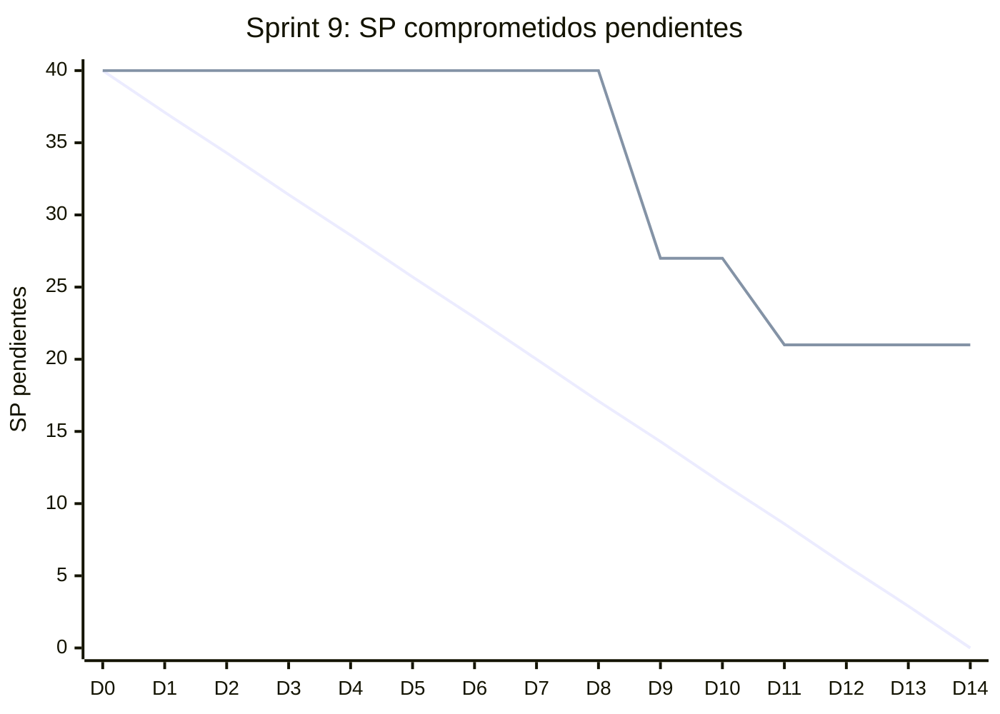

# Informe del Sprint 9

**Fechas:** 12/10/2026 al 25/10/2026 · **Release:** R3 · Chat y MediPass · **Estado:** cerrado

## Objetivo

Ronda de merges del 20/10, release 2.0.0 de mobile y MediPass contra la API real.

## Métricas

| Métrica | Valor |
|---|---|
| Comprometido | 8 issues · 40 SP |
| Comprometido y entregado en el sprint | 4 issues · 19 SP (50 % de los issues) |
| Entregado en el sprint (comprometido o no) | 27 issues |
| **Velocity** (SP entregados en el sprint) | **77 SP** |
| PRs mergeados | 31 |
| Entregado por tipo | HU: 19, TT: 8 |

## Burndown del compromiso

La línea que baja en recta es la ideal; la otra, lo que quedaba pendiente al final de cada día (SP, según la fecha de entrega). Lo que se entregó después del sprint queda como pendiente hasta el día 14.

## Historias comprometidas

| Issue | Título | Tipo | SP | Entrega | Entregado en |
|---|---|---|---|---|---|
| ENG-71 | Recibir notificación push en mobile por nuevos mensajes | HU | 5 | — | Backlog |
| ENG-73 | Acceder al MediPass de un paciente como consultante externo con el código | HU | 8 | 20/10 | Sprint 9 |
| ENG-74 | Ver qué consultantes están accediendo a mi MediPass en tiempo real | HU | 3 | 22/10 | Sprint 9 |
| ENG-75 | Revocar el acceso de un consultante al MediPass en cualquier momento | HU | 3 | 22/10 | Sprint 9 |
| ENG-103 | Ver mi MediPass con resumen de mi información clínica | HU | 5 | 20/10 | Sprint 9 |
| ENG-117 | Ver mi MediPass y generar el código QR desde la app mobile | HU | 8 | 03/11 | Sprint 10 |
| ENG-118 | Escanear un MediPass como consultante externo desde la app mobile | HU | 8 | — | Backlog |
| ENG-175 | Cerrar el INSERT directo sobre appointments | Bug | — | 27/10 | Sprint 10 |

## Entregado fuera de lo comprometido

Entraron en este sprint, pero estaban comprometidas en otro o no tenían sprint:

| Issue | Título | Tipo | SP | Entrega | Comprometida en |
|---|---|---|---|---|---|
| ENG-63 | Integrar pago de turno con MercadoPago al reservar | HU | 8 | 20/10 | Sprint 6 |
| ENG-67 | Definir política de cancelación con plazos y reembolsos | HU | 3 | 22/10 | Sprint 6 |
| ENG-68 | Enviar email de confirmación al reservar y recordatorios | HU | 8 | 20/10 | Sprint 7 |
| ENG-69 | Notificar in-app al profesional cuando un paciente reserva un turno | HU | 3 | 22/10 | Sprint 7 |
| ENG-72 | Generar código MediPass rotatorio cada 5 minutos | HU | 8 | 20/10 | Sprint 8 |
| ENG-76 | Ver el historial de accesos a mi MediPass | HU | 3 | 22/10 | Sprint 8 |
| ENG-83 | Configurar Sentry en backend, web y mobile | TT | — | 21/10 | Sprint 3 |
| ENG-87 | Implementar audit log inmutable de accesos a HC y MediPass | TT | 5 | 19/10 | Sprint 8 |
| ENG-99 | Configurar Sentry en mobile (Expo) | TT | 2 | 19/10 | Sprint 6 |
| ENG-100 | Corregir una entrada de HC | HU | 5 | 13/10 | Sprint 5 |
| ENG-101 | Liberar automáticamente turnos no pagados después de 15 minutos | HU | 3 | 20/10 | Sprint 6 |
| ENG-108 | Implementar política de retención y backup de Supabase | TT | 3 | 13/10 | Sprint 6 |
| ENG-130 | Actualizar la app mobile a Expo SDK 57 | TT | 1 | 14/10 | Sprint 7 |
| ENG-131 | Ingresar a la videoconsulta desde la app mobile | HU | — | 20/10 | sin sprint |
| ENG-132 | Buscar profesionales y ver su perfil desde la app mobile | HU | — | 20/10 | sin sprint |
| ENG-133 | Ver disponibilidad y reservar un turno desde la app mobile | HU | — | 20/10 | sin sprint |
| ENG-134 | Campos vitales del paciente y seed de los casos del juego de la jornada | TT | 3 | 22/10 | Sprint 10 |
| ENG-135 | Conectar las pantallas web de MediPass a la API real (jornada) | HU | 3 | 20/10 | sin sprint |
| ENG-140 | Aceptar términos, política de privacidad y consentimiento al registrarse | TT | — | 20/10 | Sprint 10 |
| ENG-141 | Juego "Médico de guardia" para el stand de la jornada del 06/10 | HU | — | 13/10 | sin sprint |
| ENG-142 | Recuperar contraseña con enlace por email | HU | — | 19/10 | sin sprint |
| ENG-143 | Pedir la aceptación de términos y consentimiento en la app mobile | HU | — | 20/10 | sin sprint |
| ENG-170 | Cerrar los dos hallazgos de seguridad del spike ENG-105 | TT | — | 22/10 | sin sprint |

## Incremento: PRs mergeados

**backend** (15)

- [#60](https://github.com/Proyecto-final-Mediconnect/mediconnect-backend/pull/60) fix(clinical-records): reintentar cuando el trigger de la cadena frena la colisión (ENG-100) · 19/10
- [#61](https://github.com/Proyecto-final-Mediconnect/mediconnect-backend/pull/61) feat(payments): cobrar el turno con MercadoPago Checkout Pro (ENG-63) · 19/10
- [#62](https://github.com/Proyecto-final-Mediconnect/mediconnect-backend/pull/62) feat(audit): audit_logs y medipass_access_logs append-only (ENG-87) · 19/10
- [#64](https://github.com/Proyecto-final-Mediconnect/mediconnect-backend/pull/64) feat(auth): recuperar contraseña con enlace por email (ENG-142) · 19/10
- [#67](https://github.com/Proyecto-final-Mediconnect/mediconnect-backend/pull/67) feat(legal): desacoplar el deploy del backend y de la web con LEGAL_ENFORCEMENT (ENG-140) · 20/10
- [#63](https://github.com/Proyecto-final-Mediconnect/mediconnect-backend/pull/63) feat(legal): exigir y registrar la aceptación de términos y consentimiento (ENG-140) · 20/10
- [#65](https://github.com/Proyecto-final-Mediconnect/mediconnect-backend/pull/65) feat(appointments): liberar los turnos que no se pagan en 15 minutos (ENG-101) · 20/10
- [#66](https://github.com/Proyecto-final-Mediconnect/mediconnect-backend/pull/66) feat(notifications): emails de confirmación y recordatorios de turno (ENG-68) · 20/10
- [#68](https://github.com/Proyecto-final-Mediconnect/mediconnect-backend/pull/68) feat(medipass): código rotativo y acceso de emergencia (ENG-72, ENG-73, ENG-103) · 20/10
- [#70](https://github.com/Proyecto-final-Mediconnect/mediconnect-backend/pull/70) feat(medipass): ver y cortar los accesos abiertos (ENG-74, ENG-75) · 22/10
- [#71](https://github.com/Proyecto-final-Mediconnect/mediconnect-backend/pull/71) fix(medipass): unicidad del código y techo global del canje (ENG-170) · 22/10
- [#72](https://github.com/Proyecto-final-Mediconnect/mediconnect-backend/pull/72) feat(professionals): política de cancelación del profesional (ENG-67) · 22/10
- [#73](https://github.com/Proyecto-final-Mediconnect/mediconnect-backend/pull/73) feat(patients): los campos vitales del paciente (ENG-134) · 22/10
- [#74](https://github.com/Proyecto-final-Mediconnect/mediconnect-backend/pull/74) feat(notifications): avisos in-app al profesional (ENG-69) · 22/10
- [#75](https://github.com/Proyecto-final-Mediconnect/mediconnect-backend/pull/75) feat(medipass): historial de accesos del paciente (ENG-76) · 22/10

**web** (9)

- [#35](https://github.com/Proyecto-final-Mediconnect/mediconnect-web/pull/35) feat(clinical-records): corregir una entrada desde la pantalla del profesional (ENG-100) · 13/10
- [#42](https://github.com/Proyecto-final-Mediconnect/mediconnect-web/pull/42) feat(auth): pantallas para recuperar la contraseña (ENG-142) · 19/10
- [#43](https://github.com/Proyecto-final-Mediconnect/mediconnect-web/pull/43) fix(payments): cerrar los hallazgos de la review de la pantalla de pago (ENG-63) · 20/10
- [#44](https://github.com/Proyecto-final-Mediconnect/mediconnect-web/pull/44) fix(legal): cerrar los dos hallazgos abiertos de la review del consentimiento (ENG-140) · 20/10
- [#40](https://github.com/Proyecto-final-Mediconnect/mediconnect-web/pull/40) feat(payments): pagar el turno con MercadoPago y esperar la confirmación al volver (ENG-63) · 20/10
- [#41](https://github.com/Proyecto-final-Mediconnect/mediconnect-web/pull/41) feat(legal): términos, privacidad y consentimiento al registrarse (ENG-140) · 20/10
- [#36](https://github.com/Proyecto-final-Mediconnect/mediconnect-web/pull/36) feat(medipass): conectar el MediPass y la vista de emergencia a la API (ENG-135) · 20/10
- [#45](https://github.com/Proyecto-final-Mediconnect/mediconnect-web/pull/45) feat(notifications): campanita de avisos en el shell privado (ENG-69) · 22/10
- [#46](https://github.com/Proyecto-final-Mediconnect/mediconnect-web/pull/46) feat(medipass): historial de accesos en la pantalla del MediPass (ENG-76) · 22/10

**mobile** (7)

- [#14](https://github.com/Proyecto-final-Mediconnect/mediconnect-mobile/pull/14) ci(mobile): correr el CI en cualquier PR y al cambiarle la base (ENG-128) · 19/10
- [#13](https://github.com/Proyecto-final-Mediconnect/mediconnect-mobile/pull/13) feat(observability): Sentry en la app mobile (ENG-99) · 19/10
- [#16](https://github.com/Proyecto-final-Mediconnect/mediconnect-mobile/pull/16) fix(auth): un logout que no limpia el dispositivo no es un logout (ENG-114) · 20/10
- [#12](https://github.com/Proyecto-final-Mediconnect/mediconnect-mobile/pull/12) feat(mobile): buscar profesionales, reservar un turno y entrar a la videoconsulta (ENG-131, ENG-132, ENG-133) · 20/10
- [#15](https://github.com/Proyecto-final-Mediconnect/mediconnect-mobile/pull/15) feat(legal): pedir la aceptación de términos y consentimiento en la app (ENG-143) · 20/10
- [#17](https://github.com/Proyecto-final-Mediconnect/mediconnect-mobile/pull/17) test(mobile): el saludo del inicio depende de la hora, las aserciones no · 20/10
- [#11](https://github.com/Proyecto-final-Mediconnect/mediconnect-mobile/pull/11) Release 2.0.0 — la app mobile del paciente (ENG-110 a ENG-128) · 20/10

## Desvíos, impedimentos y decisiones

- **20/10, ronda de merges:** entraron 14 PRs en una noche y `release/2.0.0` de mobile llegó a `main`.
- **Incidente:** web#36 (MediPass contra la API) se mergeó antes que su backend, y la pantalla falló en producción hasta backend#68.
- Tres PRs verdes por separado dejaron rojo el árbol combinado: es el caso de ENG-128, que sigue abierto.

**No se completó en el sprint:** ENG-71 (Backlog), ENG-117 (entregada en el Sprint 10), ENG-118 (Backlog), ENG-175 (entregada en el Sprint 10).

---

_Generado con `datos/generar.py` a partir de la foto de Linear del 03/11/2026 y de los PRs mergeados de los cuatro repos. Metodología en el [índice](README.md)._
