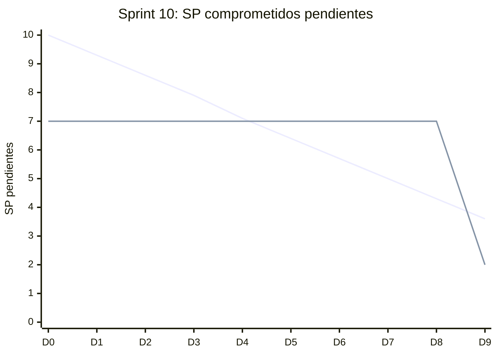

# Informe del Sprint 10

**Fechas:** 26/10/2026 al 08/11/2026 · **Release:** R3 · Chat y MediPass · **Estado:** en curso (foto del 03/11/2026)

## Objetivo

Completar MediPass, reseñas, documentos del paciente, seguridad del Sprint 0 y ARCO.

## Métricas

| Métrica | Valor |
|---|---|
| Comprometido | 38 issues · 10 SP |
| Comprometido y entregado en el sprint | 25 issues · 8 SP (66 % de los issues) |
| Entregado en el sprint (comprometido o no) | 31 issues |
| **Velocity** (SP entregados en el sprint) | **41 SP** |
| PRs mergeados | 53 |
| Entregado por tipo | Bug: 2, HU: 20, Spike: 1, TT: 8 |

## Burndown del compromiso

La línea que baja en recta es la ideal; la otra, lo que quedaba pendiente al final de cada día (SP, según la fecha de entrega). Lo que se entregó después del sprint queda como pendiente hasta el día 14.

## Historias comprometidas

| Issue | Título | Tipo | SP | Entrega | Entregado en |
|---|---|---|---|---|---|
| ENG-80 | Dejar reseña sobre un profesional tras una consulta finalizada | HU | — | 03/11 | Sprint 10 |
| ENG-81 | Moderar reseñas pendientes como moderador | HU | — | 03/11 | Sprint 10 |
| ENG-82 | Ver reseñas aprobadas en el perfil del profesional | HU | — | 03/11 | Sprint 10 |
| ENG-128 | Las aprobaciones y los checks sobreviven a cambios que nunca se revisaron | TT | 1 | — | Todo |
| ENG-134 | Campos vitales del paciente y seed de los casos del juego de la jornada | TT | 3 | 22/10 | Sprint 9 |
| ENG-136 | Cargar y editar mis datos vitales para el MediPass | HU | 5 | 03/11 | Sprint 10 |
| ENG-137 | Decidir si el código MediPass es de un solo uso | Spike | 1 | — | In Review |
| ENG-138 | Usar un rol dedicado para el backend en la base | TT | — | — | In Review |
| ENG-139 | Identificar al consultante externo del MediPass con nombre y matrícula | TT | — | — | Todo |
| ENG-140 | Aceptar términos, política de privacidad y consentimiento al registrarse | TT | — | 20/10 | Sprint 9 |
| ENG-144 | Detectar y reembolsar un segundo pago aprobado sobre la misma preferencia | TT | — | 27/10 | Sprint 10 |
| ENG-147 | Exigir turno CONFIRMADO para entrar a la videoconsulta | TT | — | 27/10 | Sprint 10 |
| ENG-148 | Sincronizar release/2.0.0 con main y publicar la release 2.0.0 con tags | TT | — | — | Todo |
| ENG-149 | Elegir qué información ve un consultante externo del MediPass | HU | — | 03/11 | Sprint 10 |
| ENG-150 | Sacar los datos inventados del catálogo y del perfil público del profesional | TT | — | 03/11 | Sprint 10 |
| ENG-151 | Borrar el banco de pruebas del spike de Daily | TT | — | — | Todo |
| ENG-154 | Informes de sprint versionados en mediconnect-docs (Sprints 1 a 11) | TT | — | — | Todo |
| ENG-155 | Pegar el Anexo A del addendum de alcance mobile en el Plan de Proyecto | TT | — | — | Todo |
| ENG-156 | Aceptar ADR-017 y actualizar el estado de ADR-003 en el Sprint 0 | TT | — | — | Todo |
| ENG-157 | Escribir los ADRs de las decisiones de arquitectura tomadas después del Sprint 0 | TT | — | — | Todo |
| ENG-158 | Actualizar el modelo de datos versionado al estado real de las migraciones | TT | — | 03/11 | Sprint 10 |
| ENG-164 | Cargar estudios y documentación clínica previa como paciente | HU | — | 03/11 | Sprint 10 |
| ENG-165 | Ver quién accedió a mi historia clínica | HU | — | 03/11 | Sprint 10 |
| ENG-166 | Implementar los controles de seguridad que promete el Sprint 0 | TT | — | 03/11 | Sprint 10 |
| ENG-167 | Documentar las diferencias de seguridad con el Sprint 0 y la ubicación de los datos | TT | — | — | Todo |
| ENG-168 | Pagar el turno con MercadoPago desde la app mobile | HU | — | 27/10 | Sprint 10 |
| ENG-169 | Mejorar "Mis turnos" y la búsqueda de "Sacar un turno" en la app mobile | HU | — | 27/10 | Sprint 10 |
| ENG-171 | Configurar la política de cancelación en la web y mostrarla al reservar y al cancelar | HU | — | 27/10 | Sprint 10 |
| ENG-172 | Volver automáticamente a la app después de pagar en MercadoPago | HU | — | 27/10 | Sprint 10 |
| ENG-173 | Mostrar la política de cancelación y el reembolso en la app mobile | HU | — | 27/10 | Sprint 10 |
| ENG-174 | Mostrar el estado del reembolso de un turno cancelado (web y mobile) | HU | — | — | In Review |
| ENG-176 | Acceder al MediPass en una emergencia con el paciente inconsciente | HU | — | — | In Review |
| ENG-177 | Avisarle al paciente cada vez que alguien abre su MediPass | HU | — | 03/11 | Sprint 10 |
| ENG-178 | Rediseñar "Mis turnos" (detalle en panel lateral) y el panel del paciente en la web | HU | — | 27/10 | Sprint 10 |
| ENG-179 | Reprogramar un turno con la política de cancelación guardada en el turno, no la vigente | TT | — | 03/11 | Sprint 10 |
| ENG-180 | Evitar dos devoluciones sobre el mismo pago cuando el pago entra mientras se cancela el turno | Bug | — | 03/11 | Sprint 10 |
| ENG-181 | Subir la app mobile a Expo SDK 58 para poder abrirla con Expo Go en iPhone | TT | — | 03/11 | Sprint 10 |
| ENG-184 | Rediseñar la pantalla de Mensajes con "escribiendo" y "Leído" al instante | HU | — | 03/11 | Sprint 10 |

## Entregado fuera de lo comprometido

Entraron en este sprint, pero estaban comprometidas en otro o no tenían sprint:

| Issue | Título | Tipo | SP | Entrega | Comprometida en |
|---|---|---|---|---|---|
| ENG-65 | Cancelar un turno y recibir reembolso si corresponde | HU | 5 | 27/10 | Sprint 7 |
| ENG-66 | Reprogramar un turno respetando la política de cancelación del profesional | HU | 5 | 27/10 | Sprint 7 |
| ENG-70 | Enviar y recibir mensajes entre paciente y profesional fuera de la consulta | HU | 8 | 27/10 | Sprint 8 |
| ENG-104 | Expirar automáticamente las sesiones MediPass después de 30 minutos | HU | 3 | 03/11 | Sprint 8 |
| ENG-105 | Validación del diseño criptográfico del código MediPass | Spike | 5 | 03/11 | Sprint 8 |
| ENG-117 | Ver mi MediPass y generar el código QR desde la app mobile | HU | 8 | 03/11 | Sprint 9 |
| ENG-121 | Checklist de testing manual en emulador Android para historias mobile | TT | 2 | 03/11 | Sprint 5 |
| ENG-175 | Cerrar el INSERT directo sobre appointments | Bug | — | 27/10 | Sprint 9 |

## Incremento: PRs mergeados

**backend** (21)

- [#79](https://github.com/Proyecto-final-Mediconnect/mediconnect-backend/pull/79) fix(appointments): cerrar el INSERT directo sobre appointments (ENG-175) · 27/10
- [#76](https://github.com/Proyecto-final-Mediconnect/mediconnect-backend/pull/76) feat(video): exigir el turno pagado para entrar a la videoconsulta (ENG-147) · 27/10
- [#80](https://github.com/Proyecto-final-Mediconnect/mediconnect-backend/pull/80) feat(conversations): chat paciente–profesional con RLS para Realtime (ENG-70) · 27/10
- [#77](https://github.com/Proyecto-final-Mediconnect/mediconnect-backend/pull/77) feat(pagos): volver a la app después de pagar en MercadoPago (ENG-172) · 27/10
- [#78](https://github.com/Proyecto-final-Mediconnect/mediconnect-backend/pull/78) feat(payments): reembolsar al cancelar un turno pagado (ENG-65) · 27/10
- [#82](https://github.com/Proyecto-final-Mediconnect/mediconnect-backend/pull/82) feat(pagos): devolver los pagos duplicados o sobre turnos inactivos (ENG-144) · 27/10
- [#69](https://github.com/Proyecto-final-Mediconnect/mediconnect-backend/pull/69) fix: fechas del turno y búsqueda de profesionales en la API para la app · 27/10
- [#81](https://github.com/Proyecto-final-Mediconnect/mediconnect-backend/pull/81) feat(turnos): reprogramar un turno respetando la política de cancelación (ENG-66) · 27/10
- [#83](https://github.com/Proyecto-final-Mediconnect/mediconnect-backend/pull/83) fix(pagos): reprogramar con la política del turno y no devolver dos veces el mismo pago (ENG-179, ENG-180) · 03/11
- [#89](https://github.com/Proyecto-final-Mediconnect/mediconnect-backend/pull/89) feat(turnos): estado del reembolso en los turnos cancelados (ENG-174) · 03/11
- [#84](https://github.com/Proyecto-final-Mediconnect/mediconnect-backend/pull/84) feat(medipass): el paciente elige qué ve un consultante externo (ENG-149) · 03/11
- [#87](https://github.com/Proyecto-final-Mediconnect/mediconnect-backend/pull/87) feat(medipass): avisarle al paciente cuando alguien abre su MediPass (ENG-177) · 03/11
- [#88](https://github.com/Proyecto-final-Mediconnect/mediconnect-backend/pull/88) feat(medipass): cerrar solos los accesos vencidos o cortados (ENG-104) · 03/11
- [#86](https://github.com/Proyecto-final-Mediconnect/mediconnect-backend/pull/86) feat(historia-clinica): ver quién accedió a mi historia clínica (ENG-165) · 03/11
- [#90](https://github.com/Proyecto-final-Mediconnect/mediconnect-backend/pull/90) feat(historia-clinica): documentación clínica previa aportada por el paciente (ENG-164) · 03/11
- [#85](https://github.com/Proyecto-final-Mediconnect/mediconnect-backend/pull/85) feat(seguridad): helmet, auditoría de dependencias y escaneo de secretos (ENG-166) · 03/11
- [#91](https://github.com/Proyecto-final-Mediconnect/mediconnect-backend/pull/91) feat(conversations): canal privado de Realtime para "escribiendo" y "leído" (ENG-184) · 03/11
- [#92](https://github.com/Proyecto-final-Mediconnect/mediconnect-backend/pull/92) feat(reseñas): dejar, moderar y mostrar reseñas (ENG-80, ENG-81, ENG-82) · 03/11
- [#95](https://github.com/Proyecto-final-Mediconnect/mediconnect-backend/pull/95) build(deps): bump actions/checkout from 4 to 7 · 03/11
- [#93](https://github.com/Proyecto-final-Mediconnect/mediconnect-backend/pull/93) build(deps): bump actions/setup-node from 4 to 7 · 03/11
- [#94](https://github.com/Proyecto-final-Mediconnect/mediconnect-backend/pull/94) build(deps): bump pnpm/action-setup from 4 to 5 · 03/11

**web** (16)

- [#47](https://github.com/Proyecto-final-Mediconnect/mediconnect-web/pull/47) feat(video): pedir el pago antes de entrar a la videoconsulta (ENG-147) · 27/10
- [#52](https://github.com/Proyecto-final-Mediconnect/mediconnect-web/pull/52) fix(header): mostrar Ingresar sin esperar a /me cuando no hubo sesión · 27/10
- [#49](https://github.com/Proyecto-final-Mediconnect/mediconnect-web/pull/49) feat(chat): pantalla de Mensajes con Supabase Realtime (ENG-70) · 27/10
- [#48](https://github.com/Proyecto-final-Mediconnect/mediconnect-web/pull/48) feat(turnos): política de cancelación y reembolso en la web (ENG-171, ENG-65) · 27/10
- [#50](https://github.com/Proyecto-final-Mediconnect/mediconnect-web/pull/50) feat(turnos): reprogramar un turno desde "Mis turnos" (ENG-66) · 27/10
- [#51](https://github.com/Proyecto-final-Mediconnect/mediconnect-web/pull/51) feat(turnos): "Mis turnos" con detalle en panel lateral y panel del paciente renovado (ENG-178) · 27/10
- [#53](https://github.com/Proyecto-final-Mediconnect/mediconnect-web/pull/53) feat: historia clínica renovada, MediPass (logo, revocar, datos de emergencia) en la web · 03/11
- [#54](https://github.com/Proyecto-final-Mediconnect/mediconnect-web/pull/54) fix(catalogo): sacar los datos inventados del catálogo y del perfil público (ENG-150) · 03/11
- [#59](https://github.com/Proyecto-final-Mediconnect/mediconnect-web/pull/59) feat(reseñas): dejar, moderar y ver reseñas (ENG-80, ENG-81, ENG-82) · 03/11
- [#57](https://github.com/Proyecto-final-Mediconnect/mediconnect-web/pull/57) feat(historia-clinica): subir documentación clínica previa (ENG-164) · 03/11
- [#55](https://github.com/Proyecto-final-Mediconnect/mediconnect-web/pull/55) feat(seguridad): CSP y headers del sitio, auditoría y escaneo de secretos (ENG-166) · 03/11
- [#58](https://github.com/Proyecto-final-Mediconnect/mediconnect-web/pull/58) feat(chat): rediseño de Mensajes con "escribiendo" y "Leído" al instante (ENG-184) · 03/11
- [#62](https://github.com/Proyecto-final-Mediconnect/mediconnect-web/pull/62) build(deps): bump actions/checkout from 4 to 7 · 03/11
- [#61](https://github.com/Proyecto-final-Mediconnect/mediconnect-web/pull/61) build(deps): bump actions/setup-node from 4 to 7 · 03/11
- [#60](https://github.com/Proyecto-final-Mediconnect/mediconnect-web/pull/60) build(deps): bump pnpm/action-setup from 4 to 5 · 03/11
- [#56](https://github.com/Proyecto-final-Mediconnect/mediconnect-web/pull/56) feat(turnos): estado del reembolso en los turnos cancelados (ENG-174) · 03/11

**mobile** (13)

- [#20](https://github.com/Proyecto-final-Mediconnect/mediconnect-mobile/pull/20) feat(appointments): pedir el pago antes de entrar a la videoconsulta (ENG-147) · 27/10
- [#18](https://github.com/Proyecto-final-Mediconnect/mediconnect-mobile/pull/18) feat(pagos): pagar el turno desde la app con MercadoPago (ENG-168) · 27/10
- [#21](https://github.com/Proyecto-final-Mediconnect/mediconnect-mobile/pull/21) feat(pagos): volver sola a la app después de pagar en MercadoPago (ENG-172) · 27/10
- [#19](https://github.com/Proyecto-final-Mediconnect/mediconnect-mobile/pull/19) feat(turnos): Mis turnos en una lista con detalle, y búsqueda de Sacar un turno en el backend (ENG-169) · 27/10
- [#22](https://github.com/Proyecto-final-Mediconnect/mediconnect-mobile/pull/22) feat(turnos): política de cancelación y reembolso en la app (ENG-173) · 27/10
- [#23](https://github.com/Proyecto-final-Mediconnect/mediconnect-mobile/pull/23) chore(mobile): subir a Expo SDK 58 y React Native 0.88 (ENG-181) · 03/11
- [#26](https://github.com/Proyecto-final-Mediconnect/mediconnect-mobile/pull/26) feat(turnos): estado del reembolso en los turnos cancelados (ENG-174) · 03/11
- [#25](https://github.com/Proyecto-final-Mediconnect/mediconnect-mobile/pull/25) feat(historia-clinica): línea de tiempo por mes, búsqueda y filtros en la app · 03/11
- [#24](https://github.com/Proyecto-final-Mediconnect/mediconnect-mobile/pull/24) feat(medipass): MediPass de la app contra la API real y datos de emergencia (ENG-117, ENG-136) · 03/11
- [#28](https://github.com/Proyecto-final-Mediconnect/mediconnect-mobile/pull/28) feat(reseñas): dejar una reseña y ver las aprobadas (ENG-80, ENG-82) · 03/11
- [#29](https://github.com/Proyecto-final-Mediconnect/mediconnect-mobile/pull/29) build(deps): bump actions/checkout from 4 to 7 · 03/11
- [#30](https://github.com/Proyecto-final-Mediconnect/mediconnect-mobile/pull/30) build(deps): bump actions/setup-node from 4 to 7 · 03/11
- [#27](https://github.com/Proyecto-final-Mediconnect/mediconnect-mobile/pull/27) feat(documentos): cargar estudios y documentación previa como paciente (ENG-164) · 03/11

**docs** (3)

- [#18](https://github.com/Proyecto-final-Mediconnect/mediconnect-docs/pull/18) docs(spikes): diseño criptográfico del MediPass y la sesión revocable (ENG-105) · 03/11
- [#19](https://github.com/Proyecto-final-Mediconnect/mediconnect-docs/pull/19) docs(data-model): poner el modelo de datos al día con las migraciones (ENG-158) · 03/11
- [#20](https://github.com/Proyecto-final-Mediconnect/mediconnect-docs/pull/20) docs(testing): primera corrida del checklist de emulador sobre el APK preview (ENG-121) · 03/11

## Desvíos, impedimentos y decisiones

- **03/11, segunda ronda:** se revisaron y mergearon 24 PRs de los cuatro repos.
- Se activó Dependabot (ENG-166). Sus PRs de dependencias npm se cerraron sin mergear porque no respetan los `pnpm.overrides`.
- En revisión al cierre de la foto: tarjeta de emergencia (ENG-176), derechos ARCO (ENG-86) y rol mínimo de la base (ENG-138).

**No se completó en el sprint:** ENG-128 (Todo), ENG-137 (In Review), ENG-138 (In Review), ENG-139 (Todo), ENG-148 (Todo), ENG-151 (Todo), ENG-154 (Todo), ENG-155 (Todo), ENG-156 (Todo), ENG-157 (Todo), ENG-167 (Todo), ENG-174 (In Review), ENG-176 (In Review).

---

_Generado con `datos/generar.py` a partir de la foto de Linear del 03/11/2026 y de los PRs mergeados de los cuatro repos. Metodología en el [índice](README.md)._
