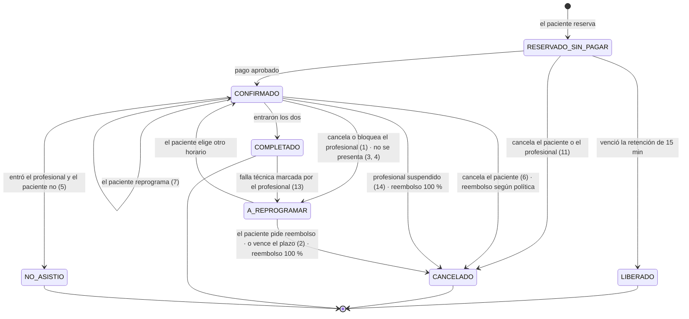

# ADR-018 — Políticas de reprogramación, cancelación y ausencias de turnos pagados

- **Estado:** Propuesto
- **Fecha:** 2026-11-17
- **Issue:** [ENG-200](https://linear.app/summercamp-pasantes/issue/ENG-200) · Épica EP-03 (Agenda y Turnos)
- **Autor:** Santino Magris
- **Aceptado por:** _pendiente — requiere un segundo desarrollador (Sprint 0 §1.7.4)_
- **Relacionado:** ENG-65 (cancelar con reembolso), ENG-66 y ENG-179 (reprogramar), ENG-189 (cierre del turno), ENG-201 (modelo de cobro), ENG-203 a ENG-208 (implementación)

## Contexto y planteo del problema

En la regularidad del 16/11/2026 los evaluadores marcaron que la gestión de turnos,
uno de los pilares de MediConnect, no está completa:

> La reprogramación no es un tema simple porque ustedes cobran por el servicio; esto
> les da la responsabilidad de gestionar la reprogramación de cada turno pagado
> directamente desde la aplicación, lo que implica desarrollar un módulo de gestión
> completo y no solo un apartado básico.

### Qué hace el sistema hoy (relevado en `main` el 17/11)

| Caso | Comportamiento actual |
| --- | --- |
| El paciente cancela | Reembolso automático por MercadoPago según la política **congelada en el turno** al reservar (ENG-65): 100 % con más de `hours_full_refund`, `partial_refund_percent` entre ambos umbrales, 0 % después. Default de plataforma 24 h / 6 h / 50 %. |
| El paciente reprograma | Una sola vez (`rescheduled_at`), y si está pagado solo mientras le correspondería el 100 % (ENG-66, ENG-179). Mismo pago y precio. |
| El profesional cancela o reprograma | **No puede**: `cancel` y `reschedule` exigen que el que llama sea el paciente. |
| El profesional bloquea un horario con turnos tomados | `createBlock` **no mira los turnos**: quedan activos en un horario bloqueado y nadie avisa. |
| El paciente no se presenta | `NO_ASISTIO` sin reembolso (manual o por job, ENG-189). |
| El profesional no se presenta, o no entra nadie | `closeFinished` solo cierra si entró el profesional: **el turno queda `CONFIRMADO` para siempre** y el paciente pagó sin recibir el servicio. En prod había 9 turnos así (limpiados en ENG-223). |
| Comisión de la plataforma | No existe (ver ENG-201). |

Los tres huecos graves están del lado del profesional: no puede gestionar sus turnos,
sus bloqueos ignoran los turnos tomados, y su ausencia deja al paciente sin servicio ni
devolución.

## Principio rector

**Si el turno no se da por causa del profesional o de la plataforma, el paciente nunca
pierde: elige otro horario sin volver a pagar o recibe el 100 %.** Las penalidades
económicas existen solo para las decisiones del propio paciente, y siempre las conoce
antes de pagar.

## Decisión

### Casos

| # | Caso | Política |
| --- | --- | --- |
| 1 | **El profesional cancela un turno pagado** (a mano o al crear un bloqueo que lo pisa) | El horario se libera y el turno pasa a `A_REPROGRAMAR`. El paciente recibe aviso (in-app, mail y push) y elige: **otro horario del mismo profesional sin volver a pagar**, o **reembolso del 100 %**. Esta reprogramación no consume la única que tiene el paciente. El profesional debe indicar un motivo. |
| 2 | **El paciente no elige** | Plazo: **hasta la hora original del turno o 48 h desde el aviso, lo que ocurra primero.** Vencido, el sistema reembolsa el 100 % y el turno queda `CANCELADO` (`cancelled_by = SISTEMA`). |
| 3 | **El profesional no se presenta** (no entra a la sala, haya entrado o no el paciente) | Al cerrar la ventana de ingreso (`JOIN_GRACE_MINUTES_AFTER`), el job lo trata como el caso 1: `A_REPROGRAMAR` con las mismas opciones y el mismo plazo, contado desde el aviso. |
| 4 | **No entra nadie** | Igual que el caso 3. Iniciar la consulta es responsabilidad del profesional, y es la única regla que no castiga al paciente sin pruebas. |
| 5 | **El paciente no se presenta** (entró el profesional y el paciente no) | Sin cambios: `NO_ASISTIO`, sin reembolso. |
| 6 | **El paciente cancela** | Sin cambios en el mecanismo (tramos según la política congelada), con **límites de plataforma** para la política que configura el profesional: `hours_full_refund ≤ 24` (el 100 % aplica al menos desde 24 h antes) y `partial_refund_percent ≥ 30`. Las políticas existentes fuera de rango se ajustan al límite en la migración. |
| 7 | **El paciente reprograma** | Sin cambios: una vez por turno, mientras le correspondería el 100 %, con el precio original. |
| 8 | **Comisión en cancelaciones** | La plataforma cobra comisión **solo sobre lo que el profesional efectivamente retiene.** Reembolso 100 % → nadie cobra. Reembolso parcial → profesional y plataforma cobran su parte en proporción a lo retenido. Quién absorbe el costo de MercadoPago lo define ENG-201. |
| 9 | **Penalidad al profesional** | No monetaria. Sus cancelaciones (casos 1 y 3) quedan registradas, se muestran en "Mi actividad" y quedan disponibles para la gestión de médicos (ENG-220). |
| 10 | **Trazabilidad** | El turno guarda `cancelled_by` (`PACIENTE` · `PROFESIONAL` · `SISTEMA`) y `cancellation_reason`. Cada transición deja una fila en `audit_logs`. |
| 11 | **El profesional cancela una reserva sin pagar** | Se cancela (`cancelled_by = PROFESIONAL`) y se avisa al paciente. No hay dinero en juego. |
| 12 | **Turno ya reprogramado por el caso 1 que se vuelve a cancelar** | Si cancela el paciente: aplica la política normal sobre el horario nuevo. Si cancela el profesional: se repite el caso 1, sin límite de veces. |
| 13 | **Entraron los dos pero la videoconsulta falló** | Dentro de las 24 h posteriores, el profesional puede marcar **"no se realizó por falla técnica"**: el turno pasa a `A_REPROGRAMAR` como en el caso 1. |
| 14 | **El profesional es suspendido o da de baja su cuenta** | Sus turnos futuros pagados se reembolsan al 100 % de forma automática (`cancelled_by = SISTEMA`); no hay con quién reprogramar. Los no pagados se cancelan con aviso. |
| 15 | **El paciente da de baja su cuenta con turnos futuros** | Se trata como cancelación del paciente: aplica la política (caso 6). |
| 16 | **Falla el reembolso en MercadoPago** | El turno no se revierte. El reembolso queda en un estado visible (`PENDIENTE` con reintento, `RECHAZADO` con motivo), se avisa al equipo y se reintenta. Nunca queda pendiente en silencio (ENG-205). |

Reglas transversales:

- El turno reprogramado conserva **el precio y el pago originales**, aunque el
  profesional haya cambiado su precio.
- El horario nuevo debe estar disponible, dentro del horizonte de reserva y respetar la
  anticipación mínima de una reserva normal.
- Los reclamos y disputas quedan fuera del sistema: se atienden por soporte y el
  historial del turno es la evidencia.

### Estados del turno

Se agrega `A_REPROGRAMAR`: turno pagado que el profesional no puede atender, con el
horario original liberado, a la espera de la elección del paciente. Mientras está en
ese estado **no ocupa horario** (no entra en el índice parcial de horarios activos).

### Cambios de modelo (orientativos; el detalle es de cada ticket)

- `appointment_status`: nuevo valor `A_REPROGRAMAR`.
- `appointments`: `cancelled_by` (enum `PACIENTE` · `PROFESIONAL` · `SISTEMA`),
  `reprogram_deadline` (timestamptz) y uso efectivo de `cancellation_reason`.
- `cancellation_policies`: validación de los límites del caso 6 (service y `CHECK`).
- El cierre automático (`closeFinished`) cubre los casos 3 y 4, y un job nuevo resuelve
  los vencimientos del caso 2. Ambos dependen de un scheduler confiable (ENG-228).

## Alternativas consideradas

- **El profesional propone un horario concreto y el paciente acepta o rechaza.**
  Descartada: agrega una negociación de ida y vuelta, más estados y más avisos, y no
  resuelve nada que no resuelva dejar elegir al paciente entre la agenda disponible.
- **Ante la ausencia del profesional, reembolso automático sin opción de reprogramar.**
  Descartada: el paciente que igual quiere atenderse con ese profesional tendría que
  volver a pagar y esperar la acreditación del reembolso.
- **Cuando no entra nadie, `NO_ASISTIO`.** Descartada: castiga al paciente sin
  evidencia de que la falta fue suya; el profesional es quien inicia la consulta.
- **Política de cancelación libre por profesional.** Descartada: permitiría políticas
  abusivas (por ejemplo 0 % siempre) en un servicio que se cobra por adelantado.

## Consecuencias

**Positivas**

- Ningún turno pagado queda sin resolución: todo camino termina en atención o en
  reembolso.
- El profesional puede gestionar su agenda real (cancelar, bloquear) sin dejar
  pacientes colgados.
- Responde directamente a la observación de la regularidad.

**Negativas / costos**

- Un estado nuevo y dos columnas: migración, y ajustes en web, mobile, reportes y
  exportaciones que enumeran estados.
- Dos jobs más críticos (ausencias y vencimientos): sin un scheduler confiable
  (ENG-228) la política no se cumple a tiempo.
- La comisión proporcional (caso 8) depende del modelo de cobro de ENG-201.

## Implementación

| Ticket | Alcance |
| --- | --- |
| ENG-204 | El profesional cancela un turno (casos 1, 2, 10, 11, 12) |
| ENG-206 | Bloqueos sobre turnos tomados (caso 1 vía bloqueo) |
| ENG-203 | El paciente elige horario desde `A_REPROGRAMAR` y reprogramación propia (7) |
| ENG-205 | Cancelación del paciente con límites y comisión (6, 8, 15, 16) |
| ENG-208 | Avisos de cada transición |
| ENG-228 | Scheduler para los jobs de los casos 2, 3 y 4 |
| ENG-237 | Ausencia del profesional y falla técnica (3, 4, 13) |
| ENG-220 | Suspensión o baja del profesional (14) y métrica de cancelaciones (9) |
