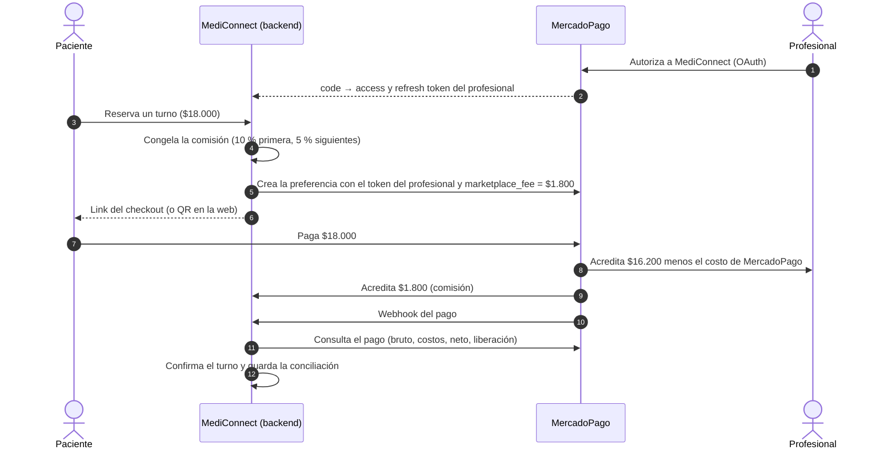

# ADR-019 — Modelo de cobro: split de MercadoPago, comisión de la plataforma y conciliación

- **Estado:** Propuesto
- **Fecha:** 2026-11-18
- **Issue:** [ENG-201](https://linear.app/summercamp-pasantes/issue/ENG-201) · Épica EP-04 (Pagos)
- **Autor:** Santino Magris
- **Aceptado por:** _pendiente — requiere un segundo desarrollador (Sprint 0 §1.7.4)_
- **Complementa:** ADR-013 (integración con MercadoPago, Sprint 0), que no definía comisión ni destino del dinero
- **Relacionado:** ADR-018 (políticas de cancelación, casos 8 y 16), ENG-64 (webhook), ENG-65 (reembolsos), ENG-194 (mis cobros), ENG-202 (cifrado), ENG-204, ENG-205, ENG-209 a ENG-213 (implementación)

## Contexto y planteo del problema

En la regularidad del 16/11/2026 los evaluadores marcaron tres fallas: el monto
cobrado no incluye comisiones, no hay pago con QR integrado y falta la conciliación
financiera con los profesionales. Internamente detectamos algo más grave: **nunca
definimos el modelo de cobro.**

### Qué hace el sistema hoy (relevado en `main` el 18/11)

| Aspecto | Comportamiento actual |
| --- | --- |
| Cuenta que cobra | Una sola: `MERCADOPAGO_ACCESS_TOKEN` global. **Todo el dinero entra a la cuenta de la plataforma.** |
| Pago al profesional | No existe. `professionals.mercadopago_account_id` está en el esquema pero ningún código la lee. |
| Comisión | No existe. La web dice "MediConnect no agrega ningún cargo propio". |
| Datos del pago | El webhook consulta el pago pero no guarda el costo de MercadoPago, el neto ni la fecha de liberación. |
| "Mis cobros" (ENG-194) | Muestra como "neto" lo cobrado menos lo reembolsado, y afirma que el cobro va directo a la cuenta del profesional, lo que es falso. |
| Reembolsos | `POST /v1/payments/:id/refunds` con el token global, con idempotencia (ENG-65). |

Se reutiliza: la preferencia de Checkout Pro, el `external_reference`, el webhook
con firma e idempotencia, la retención de 15 minutos y el servicio de reembolsos.
Cambia **con qué token se crea cada cobro** y **qué se guarda de cada pago**.

## Principios

1. **El dinero del profesional nunca pasa por la cuenta de la plataforma.** La
   plataforma cobra solo su comisión.
2. **El paciente paga el precio publicado.** Sin recargos ni sorpresas en el checkout.
3. **Todo número que se muestra sale de MercadoPago o de un porcentaje congelado
   en el turno.** Nada se estima.
4. **El paciente nunca queda sin su reembolso por un problema entre la plataforma y
   el profesional** (consistente con el principio rector del ADR-018).

## Decisión

### 1. Mecanismo: split de pagos de MercadoPago (marketplace 1:1)

- El profesional **vincula su cuenta de MercadoPago por OAuth**. La plataforma guarda
  su `user_id`, su access token y su refresh token.
- Cada cobro se crea **con el token del profesional** y con `marketplace_fee` igual a
  la comisión. MercadoPago acredita el pago en la cuenta del profesional y transfiere
  la comisión a la cuenta de la plataforma en la misma operación.
- MercadoPago descuenta primero su propio costo de la parte del profesional; la
  comisión de la plataforma sale de lo que queda.
- El plazo de liberación del dinero (al instante, 10, 18 o 35 días) lo elige el
  profesional en su cuenta. La plataforma no interviene.
- El webhook y las consultas de un pago usan el token del profesional dueño del pago.

### 2. Comisión de la plataforma

| Consulta | Comisión | Razón |
| --- | --- | --- |
| **Primera** consulta del paciente con ese profesional | **10 %** del precio | La plataforma le consiguió un paciente nuevo: es el mayor valor que aporta. |
| Consultas **siguientes** | **5 %** del precio | La plataforma aporta herramientas (agenda, cobro anticipado, video, HC, recordatorios). Con una comisión baja, cobrar por fuera deja de convenir. |

- **Primera consulta:** el paciente no tiene con ese profesional ningún otro turno en
  `CONFIRMADO`, `A_REPROGRAMAR`, `COMPLETADO` o `NO_ASISTIO`. Así, dos reservas
  simultáneas de un paciente nuevo no pagan 10 % las dos.
- El porcentaje se **congela en el turno al reservar**, como la política de
  cancelación. Una reprogramación conserva el porcentaje original.
- Los porcentajes son **configuración de plataforma** (tabla, no constantes en el
  código). Un cambio afecta solo las reservas nuevas.
- **Lo paga el profesional**: se descuenta de su cobro. El paciente ve el precio
  publicado; el profesional ve el desglose completo.
- El costo de MercadoPago también lo absorbe el profesional: en el split MercadoPago
  se lo cobra al vendedor, y depende del plazo de liberación que él elige.

**Por qué estos números.** El riesgo principal de un marketplace médico es la
desintermediación: después de la primera consulta, médico y paciente pueden
arreglar por fuera. Una comisión fija del 10 % más el costo de MercadoPago (hasta
~7,6 % con IVA al instante) lleva el costo total a ~17,6 % en cada control, y empuja
a cobrar por transferencia. Una comisión fija del 5 % no cubre con margen el costo
variable de cada consulta (videollamada, transcripción y resumen con IA,
almacenamiento, avisos). El esquema escalonado cobra fuerte donde la plataforma
aporta más y cobra poco donde es más fácil esquivarla.

### 3. Datos del profesional

- **Solo la vinculación de su cuenta de MercadoPago.** No se pide CBU, CVU ni CUIT:
  MercadoPago ya los tiene por su verificación de identidad (KYC), y el dinero nunca
  pasa por la plataforma.
- **Sin cuenta vinculada, el profesional no aparece en el catálogo ni recibe
  reservas.**
- Los tokens se guardan **cifrados a nivel aplicación**; el esquema de claves lo
  define ENG-202. Se renuevan con el refresh token antes de vencer.
- Si el token se revoca o no se puede renovar, el profesional deja de recibir
  reservas y se le avisa. Sus turnos ya pagados no se tocan: el dinero ya está en su
  cuenta.
- Al vincular, el profesional acepta los términos de cobro: la comisión, el
  descuento de deudas por reembolsos (punto 5) y la baja del catálogo por deuda.

### 4. Reembolsos

En el split, un reembolso se descuenta **proporcionalmente** de la cuenta del
profesional y de la de la plataforma. Eso cumple por sí solo el caso 8 del ADR-018:

| Situación (precio $18.000, comisión 10 %) | Paciente recibe | Profesional retiene | Plataforma retiene |
| --- | --- | --- | --- |
| Sin reembolso | — | $16.200 | $1.800 |
| Reembolso 50 % | $9.000 | $8.100 | $900 |
| Reembolso 100 % | $18.000 | $0 | $0 |

Los montos del profesional son antes del costo de MercadoPago. Qué parte de ese costo
devuelve MercadoPago en un reembolso parcial **no está documentado**: lo responde la
prueba de concepto y la conciliación usa siempre el valor que informa MercadoPago.

### 5. Reembolso fallido por falta de saldo del profesional

Un reembolso se puede hacer contra dinero aún no liberado, así que solo falla si el
profesional cobra al instante y ya retiró el dinero. Es un caso borde, pero tiene
camino definido (extiende el caso 16 del ADR-018):

1. **Reintento automático durante 48 h**, con aviso al profesional para que cargue
   saldo.
2. **Si sigue fallando, la plataforma le paga al paciente.** La parte de la plataforma
   se reembolsa por la API; la del profesional no se puede (el pago es suyo), así que
   soporte transfiere al alias o CVU del paciente. El paciente recibe un plazo
   concreto y nunca queda sin su dinero.
3. **La deuda queda registrada a nombre del profesional** y se recupera sumándola al
   `marketplace_fee` de sus próximos cobros, **con un tope del 50 % de cada pago**. El
   paciente paga el mismo precio; el profesional lo ve en su conciliación.
4. **Si a los 30 días la deuda sigue abierta**, el profesional sale del catálogo hasta
   saldarla.

### 6. QR

- **Web:** opción "Pagar con QR", que muestra el link del mismo checkout como código QR.
  El paciente lo escanea con el celular y paga en la app de MercadoPago. La pantalla
  se confirma sola cuando llega el webhook. El QR vence con la retención de 15
  minutos.
- **Mobile:** sin QR (no se puede escanear la propia pantalla); sigue abriendo la app
  de MercadoPago.
- Mismo cobro, mismo split y mismo webhook: no es un flujo de pago nuevo.

### 7. Conciliación

Por cada pago se guarda lo que informa MercadoPago: **bruto, comisión de la
plataforma, costo de MercadoPago, neto del profesional, estado y fecha de
liberación**, además del porcentaje congelado.

- **Panel del profesional** (ENG-213): esos datos por turno y totales, reembolsos y
  deudas.
- **Panel de la plataforma:** comisiones cobradas por período y por profesional,
  reembolsos y deudas abiertas.
- **Job diario de conciliación:** compara los pagos de los últimos días contra
  MercadoPago y registra las diferencias (estado, montos, reembolsos que no
  conocemos).

### 8. Facturación e impuestos (se documenta, no se implementa)

- El profesional le factura su servicio al paciente, según su condición fiscal ante
  ARCA.
- La plataforma le factura su comisión al profesional.
- MercadoPago actúa como agente de retención y percepción según la jurisdicción.
- El comprobante que genera MediConnect sigue siendo **no fiscal**.

### 9. Transición

- Los pagos existentes quedan marcados como modelo `CENTRALIZADO`: sus reembolsos
  siguen usando el token de la plataforma. Los nuevos son `SPLIT`.
- Los profesionales sin cuenta vinculada dejan de aparecer en el catálogo. Antes de
  activarlo, se les avisa y se vinculan las cuentas de prueba de la demo.

## Flujo del dinero

## Cambios de modelo (orientativos; el detalle es de cada ticket)

- **Cuenta de cobro del profesional:** `user_id` de MercadoPago, tokens cifrados,
  vencimiento, estado (`VINCULADA` · `REVOCADA` · `ERROR`) y fecha de vinculación.
  Reemplaza a `mercadopago_account_id`.
- **`appointments`:** porcentaje de comisión congelado y si fue primera consulta.
- **`payments`:** modelo (`CENTRALIZADO` · `SPLIT`), `collector_id`, comisión
  (porcentaje y monto), costo de MercadoPago, neto, fecha de liberación y la deuda
  recuperada en ese cobro.
- **Configuración de plataforma:** porcentajes de comisión (primera y siguientes),
  tope de recuperación de deuda y plazo de baja por deuda.
- **Deudas del profesional:** origen (reembolso), monto, saldo, estado, y sus
  recuperaciones.
- **Diferencias de conciliación:** pago, campo, valor local, valor de MercadoPago y
  resolución.

## Prueba de concepto en sandbox

Con usuarios de prueba de MercadoPago (vendedor y comprador) y la app de la
plataforma:

1. Vincular al vendedor de prueba por OAuth y obtener sus tokens.
2. Renovar el token con el refresh token.
3. Crear una preferencia con el token del vendedor y `marketplace_fee`.
4. Pagar con el comprador de prueba y verificar en el pago el reparto
   (`fee_details`, neto, fecha de liberación) y que el webhook llega.
5. Reembolsar el 50 % y verificar la proporción entre las dos cuentas y qué pasa con
   el costo de MercadoPago.
6. Reembolsar el resto y verificar que la comisión vuelve a cero.

Si algún paso no funciona en sandbox, este ADR se revisa antes de implementar.

## Alternativas consideradas

- **Cobro centralizado y liquidación periódica por CBU.** Descartada: la plataforma
  custodiaría dinero de terceros (con implicancias regulatorias e impositivas, ya que
  todo el cobro figuraría como ingreso propio), MercadoPago no ofrece una API pública
  de transferencias para automatizar las liquidaciones, y es justamente lo que
  marcaron los evaluadores.
- **Comisión a cargo del paciente ("cargo por servicio").** Descartada: encarece el
  precio publicado, agrega una línea que el paciente no espera y complica los
  reembolsos (habría que decidir si el cargo se devuelve).
- **Comisión fija del 10 %.** Descartada: costo total cercano al 18 % en cada control,
  lo que incentiva cobrar por fuera.
- **Comisión fija del 5 %.** Descartada: no cubre con margen el costo variable por
  consulta cuando entra la IA.
- **QR dinámico de la API de Orders.** Descartado: está pensado para cobro presencial
  y exige crear una sucursal y una caja por profesional.
- **Embeber el pago en la app (Checkout API / Bricks).** Postergada: elimina la
  redirección, pero suma manejo de tarjetas en la UI y otro flujo de cobro. Checkout
  Pro con QR alcanza para el alcance actual.
- **Ante falta de saldo, hacer esperar al paciente.** Descartada: muchos de esos
  reembolsos son del 100 % por culpa del profesional, y el paciente no tiene por qué
  financiar la deuda de otro.
- **Bajar del catálogo al profesional apenas tiene deuda.** Descartada: le impide
  generar los cobros con los que la salda.

## Consecuencias

**Positivas**

- El dinero llega al profesional y la plataforma cobra solo su comisión, con
  respaldo de MercadoPago.
- Los reembolsos proporcionales salen del mecanismo y no de código propio.
- El profesional ve cuánto cobró, cuánto se llevó cada parte y cuándo se libera.
- Responde las tres observaciones de la regularidad: comisión, QR y conciliación.

**Negativas / costos**

- OAuth, renovación de tokens y cifrado: más superficie de seguridad.
- El profesional necesita una cuenta de MercadoPago verificada para atender.
- El reembolso con falta de saldo tiene un paso manual (transferencia de soporte).
- Dos modelos de pago conviven mientras existan pagos `CENTRALIZADO`.
- La comisión escalonada requiere explicar en la UI por qué un turno pagó 10 % y otro
  5 %.

## Implementación

| Ticket | Alcance |
| --- | --- |
| ENG-209 | Vincular la cuenta de MercadoPago (OAuth, tokens cifrados, renovación, catálogo condicionado) |
| ENG-210 | Cobro con split y comisión congelada; guardar los datos de conciliación del pago |
| ENG-212 | Desglose del precio para el paciente y el profesional |
| ENG-211 | Pago con QR en la web |
| ENG-213 | Conciliación del profesional y de la plataforma, job diario |
| ENG-205 | Reembolsos en split, reembolso fallido y deudas del profesional (puntos 4 y 5) |
| ENG-204 | Reembolsos del 100 % por cancelación del profesional sobre pagos split |
