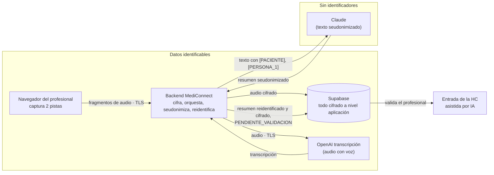

# ADR-020 — Arquitectura segura para la IA clínica y el cifrado de datos sensibles

- **Estado:** Propuesto
- **Fecha:** 2026-11-21
- **Issue:** [ENG-202](https://linear.app/summercamp-pasantes/issue/ENG-202) · Épicas EP-06 (Historia Clínica) y EP-07 (IA Clínica)
- **Autor:** Santino Magris
- **Aceptado por:** _pendiente — requiere un segundo desarrollador (Sprint 0 §1.7.4)_
- **Relacionado:** ENG-62, ENG-77, ENG-78, ENG-79, ENG-125, ENG-153 (pipeline de IA), ENG-108 (backups), ENG-167 (seguridad frente al Sprint 0), ENG-214 a ENG-217 (implementación), ADR-019 (tokens de MercadoPago)

## Contexto y planteo del problema

En la regularidad del 16/11/2026 los evaluadores marcaron que la transcripción con IA
ya debería estar implementada, y preguntaron cómo garantizamos que los datos
sensibles estén cifrados, que no se pierdan y que la IA no acceda a datos clínicos
identificables, con una solución económica. También cuestionaron la seguridad de
subir PDF a la historia clínica.

MediConnect es un proyecto académico que no va a tener usuarios reales. Igual, la
arquitectura se diseña y se implementa como si los tuviera: la decisión de
infraestructura (por ejemplo, dónde vive la clave maestra) puede ser la de un
entorno de demostración, pero el diseño tiene que permitir pasar a producción sin
migrar datos.

### Qué hay hoy (relevado en `main` el 21/11)

| Aspecto | Estado |
| --- | --- |
| Documentos del paciente y adjuntos del chat | Buckets **privados**, subida solo por el backend, descarga con URL firmada de vida corta, acceso del profesional auditado, nombre de archivo aleatorio, firma de bytes (PDF, JPG, PNG) y cuotas. |
| Contenido de los PDF | No se inspecciona: un PDF con JavaScript o archivos embebidos se acepta. |
| Historia clínica | Solo se agregan entradas (append-only), con cadena de hash que **calcula la aplicación** (ENG-57). La web y la app la leen **a través del backend**, no de Supabase directo. |
| Cifrado | Solo el de disco de Supabase. **Ningún dato se cifra a nivel aplicación.** |
| IA | No existe. `ConsultationSummary` está en el esquema pero ningún código lo usa; `OPENAI_API_KEY` y `GEMINI_API_KEY` no se leen. |
| Grabación | No existe (`VIDEO_RECORDING_MODE` apagado). |
| Logs | Sentry con depuración de datos sensibles (`config/sentry.scrubbing.ts`). |

## Principios

1. **La IA nunca escribe la historia clínica.** Propone; el profesional valida.
2. **El modelo de lenguaje nunca recibe identificadores.** Solo texto seudonimizado.
3. **Cada dato sensible vive el menor tiempo posible** y cifrado mientras vive.
4. **Ningún acceso no autorizado depende de una sola falla:** robar la base no
   alcanza sin la clave; robar la clave no alcanza sin la base.
5. **Nada se pierde en silencio:** cada falla es visible y reintentable.

## Decisión

### 1. Consentimiento

- Se pide **por turno**, es **opcional** y **revocable** hasta el inicio de la
  consulta. Sin consentimiento la consulta se hace igual, sin grabación ni IA.
- El texto dice qué se graba, para qué, qué proveedores lo procesan, en qué país,
  cuánto tiempo se guarda y cómo revocarlo.
- El consentimiento queda registrado (versión del texto, fecha, turno) en
  `audit_logs`.
- Durante la llamada, los dos participantes ven un indicador de grabación.

### 2. Captura del audio, en el navegador del profesional

- Daily Prebuilt expone las pistas de audio de cada participante
  (`participants()[id].tracks.audio.persistentTrack`). El navegador del profesional
  graba **dos pistas separadas** (profesional y paciente) con `MediaRecorder`, en
  Opus mono a 24 kbps: unos 5 MB por pista cada 30 minutos.
- Se sube **un fragmento por minuto** al backend, por TLS. Si se cierra la pestaña,
  se pierde como máximo el último minuto.
- El backend cifra cada fragmento antes de guardarlo en un bucket privado.
- **Por qué no la grabación de Daily:** es solo para planes pagos y deja el audio en
  los servidores de Daily. La captura en el navegador no cuesta nada y el audio
  nunca queda en un tercero.
- **Por qué dos pistas:** se sabe quién dijo cada cosa sin pagar diarización.

### 3. Transcripción

- Proveedor: **OpenAI** (`gpt-4o-transcribe`, USD 0,006/min; o el modelo de
  transcripción de lote vigente). La API no usa los datos para entrenar.
- Cada pista se transcribe por separado y se unen por marca de tiempo, con el
  hablante identificado.
- Deepgram Nova-3 (USD 0,0043/min) y AssemblyAI (USD 0,0025/min) quedan como
  alternativas; la prueba de concepto compara la calidad en español rioplatense
  antes de fijar el proveedor.
- **El audio no se puede anonimizar:** la voz identifica. Lo protegen el
  consentimiento, las condiciones del proveedor y el borrado inmediato (punto 7).

### 4. Seudonimización del texto antes del modelo de lenguaje

Corre en el backend, sin servicios externos, en tres capas:

1. **Diccionario exacto** con lo que el sistema ya sabe: nombre, apellido, DNI,
   mail, teléfono y dirección del paciente y del profesional. Es la capa más
   precisa.
2. **Patrones:** DNI, CUIL, teléfonos, mails, número de afiliado, fechas de
   nacimiento y URLs.
3. **Reconocimiento de entidades local:** un modelo multilingüe que corre en el
   backend detecta nombres de personas y lugares no conocidos ("mi hermana Laura",
   "vivo en Tandil").

Los hallazgos se reemplazan por marcadores consistentes (`[PACIENTE]`,
`[PROFESIONAL]`, `[PERSONA_1]`, `[LUGAR_1]`, `[DNI_1]`). La tabla de equivalencias
**nunca sale del backend**: al volver el resumen se reidentifica del lado nuestro y
la tabla se descarta.

**Límite:** combinaciones raras de datos no identificadores (una enfermedad poco
común y una ciudad chica) pueden seguir identificando a alguien. Por eso se habla de
**seudonimización** y no de anonimización, y se combina con un proveedor que no
entrena con los datos.

### 5. Resumen

- **Claude por API**, con salida estructurada (esquema JSON con formato SOAP:
  motivo, subjetivo, objetivo, evaluación, plan, indicaciones), sin herramientas.
- La transcripción va como **dato no confiable**, delimitada y con la instrucción de
  no seguir indicaciones que aparezcan en ella (defensa contra inyección de prompt).
  La salida se valida contra el esquema antes de guardarse.
- **Modelo:** **Claude Haiku 5.5** (USD 0,10 / 0,50 por millón de tokens) si pasa la
  evaluación de la prueba de concepto; si no, **Claude Opus 5.5** (USD 4 / 20). El
  modelo es configuración, no constante en el código.
- **Criterio de la evaluación:** cinco consultas ficticias con hechos esperados y
  trampas (negaciones, dosis, antecedentes, alergias). Haiku pasa si no inventa
  ningún hecho y no omite ninguno clínicamente relevante en las cinco.

### 6. Revisión del profesional

- El resumen queda `PENDIENTE_VALIDACION` en `ConsultationSummary` (se reutiliza el
  modelo).
- El profesional lo edita y lo valida: recién ahí se crea la entrada de la historia
  clínica, marcada como **asistida por IA** y con el profesional que la validó. O lo
  descarta (ENG-153).
- Si el proceso falla, el profesional lo ve y puede reintentar o escribir la
  evolución a mano.

### 7. Retención

| Dato | Vida |
| --- | --- |
| Audio | Se borra apenas se guarda la transcripción. Si el proceso falla, se borra igual a las 72 h. |
| Tabla de seudónimos | Solo durante el proceso; nunca se persiste. |
| Transcripción | Cifrada, hasta 30 días después de la validación o el descarte del resumen. No forma parte de la historia clínica. |
| Resumen descartado | Se borra. |
| Resumen validado | Es una entrada de la historia clínica: 10 años (Ley 26.529, art. 18). |

### 8. Cifrado en reposo a nivel aplicación

**Esquema: cifrado de sobre (envelope encryption).**

- Cada dato se cifra con **AES-256-GCM** usando una **clave de datos por paciente**
  (DEK).
- Las DEK se guardan cifradas con una **clave maestra** (KEK). La base nunca tiene
  una DEK en claro.
- Cada valor cifrado guarda la **versión de la KEK** (`kid`), el nonce y la etiqueta
  de autenticación. Los datos del registro (paciente, entrada) van como datos
  asociados (AAD): un valor copiado a otra fila no se descifra.
- **Rotación:** se agrega una KEK nueva y se re-cifran solo las DEK, no los datos.

**Dónde vive la KEK:** en una variable de entorno del backend en Render (entorno de
demostración). Nunca se loguea, ni se expone por ningún endpoint, ni la usa otro
servicio. Pasar a un KMS gestionado en producción cambia solo de dónde se lee la
KEK; gracias al `kid`, no requiere migrar datos.

**Qué se cifra:**

| Dato | Dónde |
| --- | --- |
| Contenido de las entradas de la historia clínica | `clinical_record_entries.content` |
| Transcripción y resumen | `consultation_summaries` |
| Audio | Bucket privado, por fragmento |
| Documentos del paciente y adjuntos del chat | Bucket privado; se descargan a través del backend en lugar de una URL firmada |
| Tokens de MercadoPago (ADR-019) | Cuenta de cobro del profesional |

**Impacto:**

- **Cadena de hash:** se sigue calculando sobre la forma canónica en claro; el job de
  integridad descifra para verificarla.
- **Entradas existentes:** quedan en claro con versión de cifrado `0`. Reescribirlas
  violaría la regla de solo agregar entradas.
- **Búsquedas:** hoy no hay búsquedas sobre el contenido clínico; si hicieran falta,
  se usaría un índice ciego (HMAC) por campo.
- **Borrado:** destruir la DEK de un paciente vuelve ilegible todo lo suyo. Se usa
  para lo que la ley permite borrar (audio, transcripciones); la historia clínica se
  conserva los 10 años.

### 9. Cifrado en tránsito

- Navegador y app ↔ backend: HTTPS, con HSTS en la web.
- Backend ↔ Supabase: TLS obligatorio (`sslmode=require`).
- Backend ↔ OpenAI y Anthropic: HTTPS.
- Videollamada: WebRTC con DTLS-SRTP (Daily).

### 10. Que nada se pierda

- **Cola de trabajos en Postgres:** cada consulta grabada genera un trabajo con
  pasos (transcribir, seudonimizar, resumir, reidentificar). Cada paso guarda su
  resultado cifrado antes del siguiente, así un reintento no repite lo ya hecho. Los
  trabajos se toman con `FOR UPDATE SKIP LOCKED` y reintentan con espera creciente.
  Los dispara el fin de la consulta y el scheduler (ENG-228).
- **Backups (ENG-108):** `pg_dump` y copia de los buckets todas las noches desde
  GitHub Actions, cifrados con una **clave pública** propia de los backups (quien
  corre el backup no puede leerlo), guardados fuera de Supabase, con una prueba de
  restauración mensual.
- **La KEK se respalda** fuera de Render, con acceso de dos personas del equipo: si
  se pierde, se pierden los datos cifrados.

### 11. Acceso y auditoría

- La transcripción y el resumen los ve **solo el profesional de esa consulta**. La
  base no permite leerlos directo (RLS sin políticas de lectura); todo pasa por el
  backend.
- El paciente ve la entrada validada en su historia clínica (Ley 26.529, art. 14).
- Cada descifrado de datos clínicos y cada llamada a un proveedor de IA queda en
  `audit_logs`, con metadatos y nunca con contenido.
- La depuración de Sentry se extiende a transcripciones, resúmenes y seudónimos.

### 12. Archivos PDF seguros (ENG-217)

- Además de la firma de bytes, se **rechazan los PDF con contenido activo**:
  JavaScript, archivos embebidos, acciones de apertura o formularios con acciones.
- Se descargan siempre como archivo (`Content-Disposition: attachment`,
  `X-Content-Type-Options: nosniff`), nunca se abren dentro de la página.
- Se cifran en reposo (punto 8).
- El escaneo antivirus queda como mejora futura, por costo.

## Flujo de datos

Las zonas marcan dónde hay datos identificables.

## Costo por consulta de 30 minutos

| Paso | Costo |
| --- | --- |
| Captura y almacenamiento | USD 0 |
| Transcripción (2 pistas) | USD 0,18 a 0,36 |
| Seudonimización (local) | USD 0 |
| Resumen | USD 0,002 (Haiku 5.5) a USD 0,06 (Opus 5.5) |
| **Total** | **USD 0,18 a 0,42** |

Entra holgado en la comisión del ADR-019.

## Normativa

- **Ley 25.326:** los datos de salud son sensibles. Requieren consentimiento expreso
  (arts. 5 y 7) y medidas de seguridad (art. 9; Res. AAIP 47/2018). Los proveedores
  están en EE. UU., que no figura entre los países adecuados: la transferencia
  internacional (art. 12) se cubre con el consentimiento expreso y las cláusulas
  contractuales modelo de la AAIP. La seudonimización reduce lo que se transfiere.
- **Ley 26.529:** confidencialidad, integridad e inalterabilidad de la historia
  clínica, y conservación por 10 años.
- **Ley 27.553:** teleasistencia y recetas electrónicas.

## Riesgos residuales

| Riesgo | Mitigación |
| --- | --- |
| El proveedor de transcripción recibe audio identificable | Consentimiento, proveedor que no entrena con los datos, borrado inmediato del audio de nuestro lado. |
| Robo simultáneo de la base y de la KEK | En producción, KMS con acceso auditado; acá, KEK solo en el backend y nunca logueada. |
| Cuenta de un profesional comprometida | MFA, acceso solo a sus pacientes, auditoría de cada descifrado. |
| Chat sin cifrado a nivel aplicación | Pasa por Supabase Realtime directo al cliente; queda protegido por RLS y el cifrado de disco. Riesgo aceptado. |
| Combinaciones raras de datos en el texto seudonimizado | Proveedor que no entrena; el resumen vuelve y se reidentifica del lado nuestro. |
| Dispositivo del paciente o del profesional comprometido | Fuera del alcance del sistema. |

## Alternativas consideradas

- **Whisper en un servidor propio.** Descartada: Render free tiene 512 MB y no tiene
  GPU; alquilar una GPU cuesta más que la API para este volumen.
- **Grabación en la nube de Daily.** Descartada: solo planes pagos y el audio queda en
  un tercero.
- **Mandar la transcripción sin seudonimizar.** Descartada: el modelo de lenguaje no
  necesita saber quién es el paciente para resumir.
- **Seudonimizar con el mismo modelo de lenguaje.** Descartada: le manda los
  identificadores justo al servicio del que se los quiere ocultar.
- **Solo el cifrado de disco de Supabase.** Descartada: protege contra el robo del
  disco, no contra el acceso a la base ni contra un backup filtrado.
- **Cifrado del lado del cliente (extremo a extremo).** Descartada: el backend
  necesita leer los datos para la IA, la cadena de hash y la integridad.
- **KMS gestionado.** Postergada para producción: el diseño con `kid` permite
  adoptarlo sin migrar datos.

## Consecuencias

**Positivas**

- La IA queda implementada de punta a punta, con revisión humana obligatoria.
- Un atacante necesita dos fallas independientes para leer datos clínicos.
- Costo por consulta muy bajo y sin infraestructura nueva.

**Negativas / costos**

- Los archivos se descargan a través del backend (más tráfico en Render).
- La captura depende del navegador del profesional: si falla, no hay resumen (la
  consulta no se afecta).
- Una clave más que custodiar y respaldar: perderla es perder los datos cifrados.
- Las entradas de historia clínica existentes quedan en claro.

## Prueba de concepto

1. **Sin claves externas:** cifrado de sobre (cifrar, descifrar, rotar la KEK) y
   seudonimización de una transcripción ficticia con las tres capas.
2. **Captura:** grabar las dos pistas en una sala de Daily de prueba y subirlas por
   fragmentos.
3. **Con claves:** transcribir un audio ficticio, seudonimizar, resumir y reidentificar.
4. **Evaluación de Haiku 5.5** con el criterio del punto 5.

## Implementación

| Ticket | Alcance |
| --- | --- |
| ENG-216 | Cifrado de sobre, columnas y buckets cifrados, backups (con ENG-108) |
| ENG-215 | Seudonimización en tres capas |
| ENG-125 | Consentimiento y captura del audio en el navegador |
| ENG-214 | Cola de trabajos y pipeline de punta a punta (ENG-77 transcripción, ENG-78 resumen) |
| ENG-79 / ENG-153 | Revisión, validación o descarte del resumen |
| ENG-217 | PDF seguros y descarga a través del backend |
